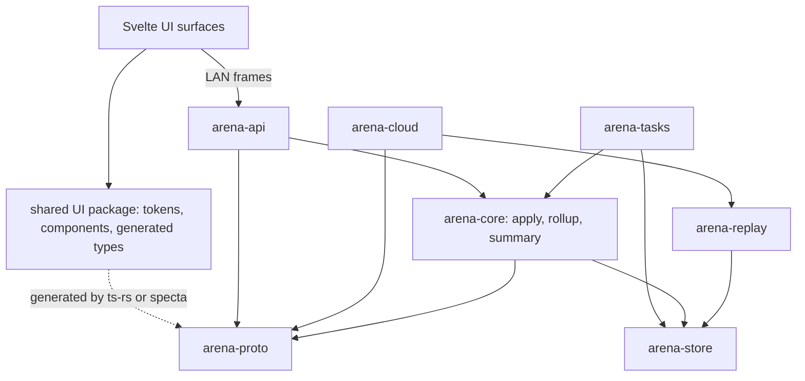
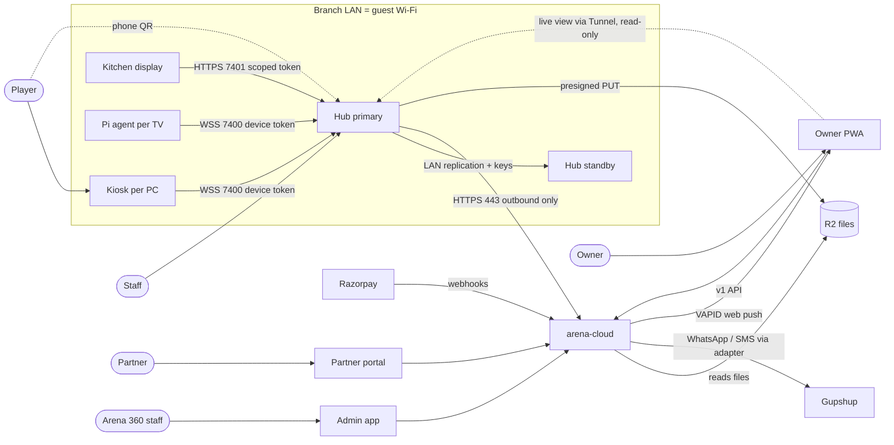
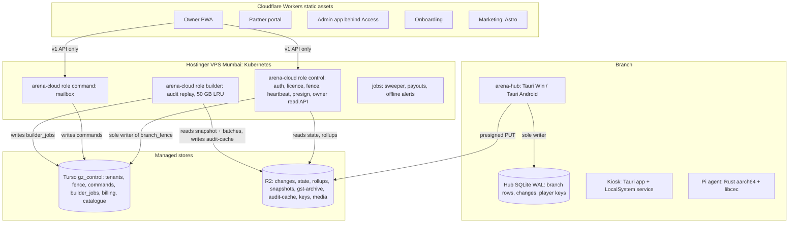
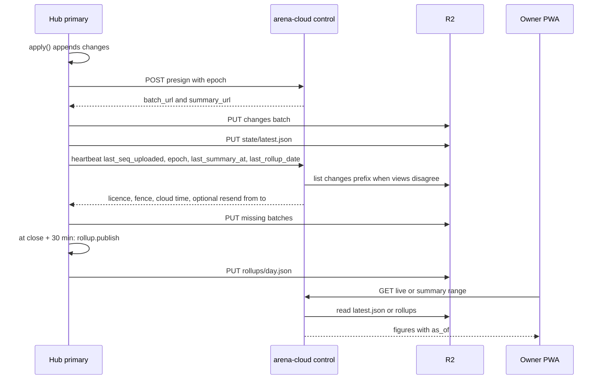
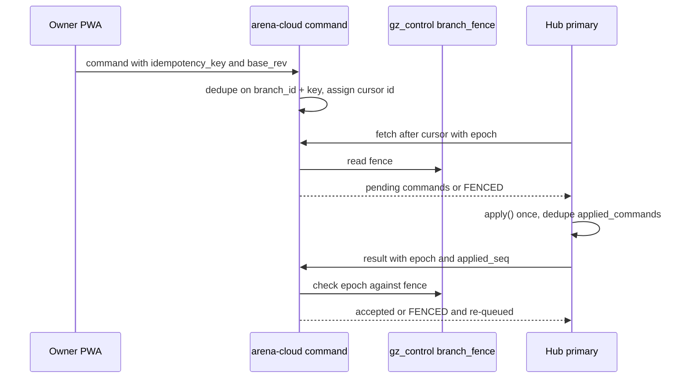
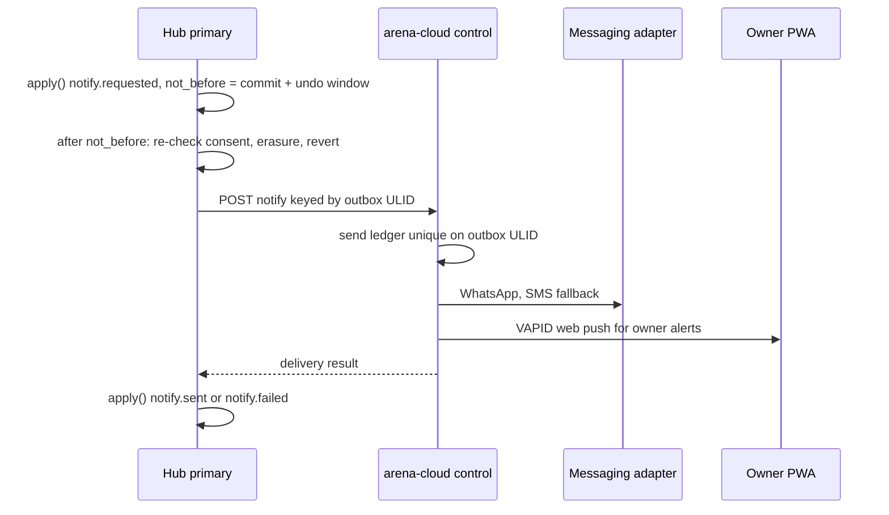
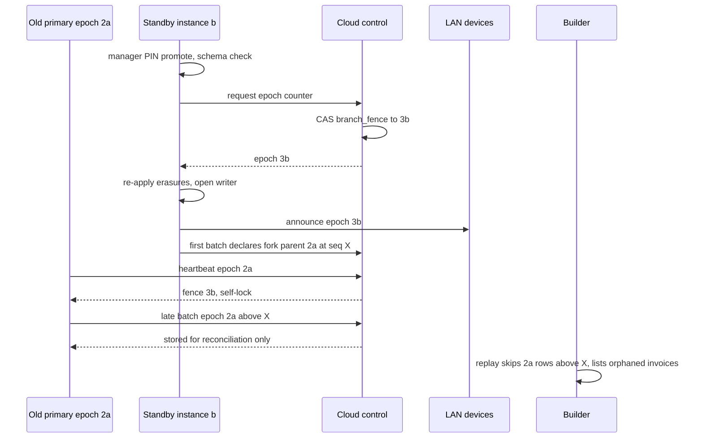

# Architecture Spine — Arena 360

## Design Paradigm

**Local-first, single writer per branch, fenced by a cloud-issued epoch.** The branch Hub primary's SQLite is the truth for that branch and its only writer. Every mutation is an intent passed through `apply()`, which appends to a gap-free, per-epoch change log (event-sourced; the log is the audit trail). **There is no cloud mirror of branch data.** The cloud is four things: **files** (R2: change-log batches, Hub-computed summary and daily rollups, snapshots, GST archives, audit caches), a **command mailbox** (owner/admin writes the Hub pulls and applies), the **licence** (signed entitlement + epoch fence), and an **on-demand builder** that replays files into a temporary audit DB. Owner reporting reads Hub-computed files; the cloud never computes branch figures from rows. The branch keeps working with no WAN.

| Layer | Lives in | May depend on |
| --- | --- | --- |
| Protocol types, error codes, permission catalogue, command catalogue, file schemas (batch, summary, rollup, export) | `arena-proto` | — |
| Storage (all SQL) | `arena-store` | rusqlite (Hub, builder); libsql (control DB only) |
| Domain + `apply()` (pure, injected `Clock`) + rollup/summary engines | `arena-core` | `arena-store` |
| Edges: WS/HTTP/KDS/phone page | `arena-api` | `arena-core` |
| Background tasks (lease, uploader, summary/rollup publisher, poller, follower, discovery, tunnel, heartbeat, printer, notify drain) | `arena-tasks` | core, store |
| Replayer (standby follow + cloud builder) | `arena-replay` | `arena-store` |
| Cloud roles: control, command, builder, jobs | `arena-cloud` | proto, replay, store |
| UI surfaces | Svelte apps + shared UI package (tokens, components, generated types) | generated `arena-proto` types only |

## Inherited Constraints (PRD + UX, read-only)

Only rows that bind architecture are listed. Product rules (ad placement and cadence, prices and add-ons, credit-override frequency, payout percentages, session time-up modes, undo window length) are owned by the PRD (`docs/Arena 360 - Product.md`) and EXPERIENCE.md and are referenced, not restated.

| Constraint | Source |
| --- | --- |
| Kiosk + Windows Hub on Tauri 2 (WebView2), Windows 10+; no WPF/.NET/MSBuild/C#/Win7 | PRD, UX |
| Android Hub on Tauri 2 mobile | PRD |
| One shared web UI + design-token codebase (tokens from DESIGN.md) | PRD, UX DESIGN.md |
| Owner app = responsive web + PWA with web push | PRD |
| Branch works fully offline | PRD, EXPERIENCE.md |
| No branch-level payment provider: UPI/card recorded by reference; no provider keys at the branch | PRD |
| Ads only on Free Android Hub; never on Kiosk or Pi TV; ad rows carry no kiosk device/creative ids (placement rules: PRD) | PRD, memlog |
| No player login on consoles; kiosk login without phone+PIN or QR | PRD |
| Owner command applied at Hub wins over prior local change and is announced | PRD, EXPERIENCE.md |
| Razorpay only for subscription billing; markets = India + Razorpay Subscriptions countries | PRD, memlog |
| Non-goal: arbitrary SQL reporting in the cloud over branch data; reports are defined rollup fields | user change list |

## Invariants & Rules

### AD-1 — Single writer per branch [ADOPTED]

- **Binds:** hub-windows, hub-android, all branch devices, cloud
- **Prevents:** split-brain; CRDT/merge logic; devices or cloud writing branch rows
- **Rule:** Only the Hub primary holding the current lease epoch (AD-38) writes branch state. Lease renews every 3 s, expires after 15 s. Every `apply()` re-reads the epoch inside its transaction and fails `NOT_PRIMARY` if superseded. Standby is a read-only follower and starts as follower if a fresh higher-epoch lease exists; a demoted process closes its writer channel. No CRDT, no multi-master.

### AD-2 — One mutation path: intent → `apply()` → change log [ADOPTED]

- **Binds:** all
- **Prevents:** side-door writes; audit gaps; divergent validation; actor namespace collisions
- **Rule:** Every state change is an intent processed by `apply()` in one `BEGIN IMMEDIATE` (permission → epoch check → TTL/dedupe → `base_rev` check (AD-39) → validate → mutate → stamp → append `changes` → commit → emit), serialised by the single Writer actor. No I/O other than SQLite inside the transaction. Each change row carries a typed `actor{kind: staff|owner|admin|system|device, id}`, `intent_id`, `elevated_by` (AD-30) and the stamped `business_day`/`fy` (AD-7). The change log is append-only and is the audit log. One permission per intent. System intents (`summary.publish`, `rollup.publish`, printer/notify results) use `actor.kind = system`.

### AD-3 — Data ownership

- **Binds:** all
- **Prevents:** two owners for one table; branch profile edited in two places; invoice prefix changing mid-series
- **Rule:** Hub writes branch rows. Cloud writes only `gz_control` tables and R2 objects it owns (audit-cache, catalogue media). Owner PWA, admin, billing and devices write only intents/commands. Onboarding values (name, tz, currency, GST registration, hours, branch code) reach the Hub as a `branch.bootstrap` command applied at first pairing; after that the Hub is the sole owner and cloud consumers read them from `state/latest.json`. `branch_code` is assigned by the control plane, unique per tenant, and locked once the first invoice exists. Branch never authors global game metadata (AD-17).

### AD-4 — Sync by change-log batches to files [ADOPTED, amended: no manifest, no ingest]

- **Binds:** hub (uploader), cloud-control (presign, heartbeat), cloud-builder, standby
- **Prevents:** divergent replication paths; silent gaps; ghost rows after a fork
- **Rule:** Paid-tier Hubs ship gap-free per-epoch change-log batches to R2 via presigned PUT (valid 10 min). `POST /presign` returns `{batch_url, summary_url}` in one call (rollup, snapshot and archive keys requested with `kind`); presign is refused `FENCED` for an epoch below `branch_fence`, except batches, which are still accepted for reconciliation. Key `tenants/<t>/branches/<b>/changes/<epoch>/<first:012>-<last:012>.zst`; payload = msgpack header (incl. `epoch`, `fork`, sha256) + full-row maps keyed by column name, zstd; ≤ 5000 rows. Upload every JWT `upload_interval_s` (floor 30 s) or 500 pending rows. The first batch of a new epoch declares `fork = {parent_epoch, parent_seq}`; its seq continues from `parent_seq + 1`; the gap check runs per epoch from there. **Gap detection is by heartbeat:** the Hub reports `last_seq_uploaded, epoch, last_summary_at, last_rollup_date`; when that disagrees with the cloud's cached view, the cloud lists the branch `changes/` prefix and the heartbeat response may carry `resend{from,to}`. No manifest endpoint, no upload-manifest or ingest-cursor tables. Standby and builder replay with the same `arena-replay`: upsert by `(tbl,row_id)`, op `D` deletes, unknown columns ignored, missing columns defaulted; parent-epoch rows above `fork.parent_seq` are **orphaned** and never replayed into state. The Hub primary produces `snapshots/<yyyy-mm-dd>.db.zst` daily after close (PII as ciphertext only, AD-24); standby bootstrap = LAN snapshot from primary + follow.

### AD-5 — Owner writes are relayed commands [ADOPTED, amended]

- **Binds:** cloud-command, owner-pwa, admin-app, hub (poller)
- **Prevents:** cloud mutating branch data directly; double-applied, skipped or lost commands; commands applied by a fenced-out Hub
- **Rule:** Owner/admin writes become rows in the single `commands` table in `gz_control` (`branch_id TEXT NOT NULL`, index `(branch_id, status, id)`). The relay assigns a monotonic `id` at insert as the fetch cursor; the client `idempotency_key` is a separate column, unique per `(branch_id, idempotency_key)`. The Hub pulls (poll on `upload_interval_s`-independent 60 s, or poke via heartbeat) `?after=<cursor>` in `id` order, and applies via `apply()` exactly once (deduped by `applied_commands` keyed on `idempotency_key`). Fetch and result POST carry the Hub's epoch; a result whose epoch is below `branch_fence` is rejected `FENCED` and the command is re-queued to `pending`; when the fence moves, commands applied at the old epoch with `applied_seq > fork.parent_seq` return to `pending`. Lifecycle `pending → fetched → applied | rejected | expired`; fetched reverts to pending after 10 min; expiry 7 days (sweeper unchanged). Commands carry `schema_version` (AD-8 negotiation); unparseable ⇒ `UNSUPPORTED`. `branch: all` fans out per branch under one `group_id` = the user's key. An applied owner command wins over prior local change and emits an "updated by owner" event naming the overwritten change. Billing never sends commands that change gates (AD-20).

### AD-6 — Network topology [ADOPTED]

- **Binds:** hub, kiosk, pi-agent, kitchen-display, cloud
- **Prevents:** inbound ports on cafe networks; branch-held provider secrets
- **Rule:** Hub is outbound-443 only. Devices ↔ Hub over LAN WebSocket `:7400` and HTTPS `:7401` (AD-42). Payment/provider webhooks terminate in the cloud only. Remote access via Cloudflare Tunnel + Access is gated by the `tunnel` entitlement flag (add-on on paid tiers, included in Premium) and carries two things only: the read-only live view (AD-43) and remote devices (kiosks/Pis outside the café LAN), which connect as the paired-device class with device token + pinned TLS (AD-42), never anonymously.

### AD-7 — Data conventions [ADOPTED, amended]

- **Binds:** all
- **Prevents:** id, money, currency and time format drift; Hub and cloud bucketing days differently
- **Rule:** ULIDs minted by the writer; `branch_id` on every branch row; money as integer **minor units** of the branch currency (`*_minor` columns; ISO 4217 code on the branch row, exponent from the code); rates in basis points; timestamps UTC ms; `rev` on mutable rows (AD-39). Branch row holds tz, `day_start_min` and FY start (India Apr–Mar, label `26-27`). `apply()` stamps `business_day` and `fy` on every session, money row and invoice; reports aggregate stamped columns and never recompute them; a tz or day-start change takes effect from the next business day. Windows = local minutes from midnight with wrap; `days_mask` bit 0 = Monday; local dates `YYYY-MM-DD`. Errors are `AppError{code, message, field?}` with stable codes in `arena-proto`; user text by code per locale, never sent over the wire.

### AD-8 — Versioning and compatibility [ADOPTED, amended]

- **Binds:** all
- **Prevents:** fleet breakage on upgrade; silent column loss on promotion; commands the Hub cannot parse
- **Rule:** Migrations forward-only and additive; `SCHEMA_TOO_NEW` on newer schema; frames carry `v`; unknown kinds return `UNSUPPORTED`; Hub accepts Kiosks from the previous two releases. The heartbeat reports the Hub's schema version and supported command `schema_version` range; the cloud API emits only versions the branch supports, else returns `BRANCH_UPDATE_REQUIRED`. A standby follows and may be promoted only if its schema ≥ the primary's, else `SCHEMA_BEHIND`; rollout updates standby before primary. Rollback = roll-forward hotfix (a previous build never opens a newer schema). Rollup files are versioned per AD-35. Enums TEXT + CHECK (Rust enum is source); booleans 0/1; catalogues soft-delete, ledgers never deleted; drop a column only two releases after nothing reads it; renames = add + backfill + drop. Shared cross-unit formats (mDNS service name, export file, Android→Windows snapshot) are defined once in `arena-proto` and versioned.

### AD-9 — Tenancy and isolation [ADOPTED, amended: control DB only]

- **Binds:** cloud, owner-pwa, partner-portal, admin-app
- **Prevents:** cross-tenant reads; per-branch databases
- **Rule:** Turso holds one database, `gz_control` (tenants, branches, licences, `branch_fence`, `commands`, `builder_jobs`, billing, partners, catalogue, rate limits, send ledger, admin audit). No per-branch DBs (`gz_b_*` removed). Branch data lives only in the Hub and in one R2 prefix per branch, `tenants/<tenant_id>/branches/<branch_id>/` (AD-36). `tenant_id` and permitted `branch_id`s come from the authenticated session only, never from request input.

### AD-10 — Identity, devices, entitlement [ADOPTED, amended]

- **Binds:** hub, kiosk, pi-agent, cloud-control, owner-pwa
- **Prevents:** unsigned licence state; reusable pairing secrets; divergent claim sets
- **Rule:** Owner: password + TOTP + backup codes; OTP via SMS on sign-up, new-device login and as TOTP fallback; fresh step-up MFA for commands flagged sensitive in the command catalogue. Staff: password + PIN; staff credentials never travel in commands (owner creates the user with a one-time setup code; staff set PIN/password at the Hub). Pairing: single-use short-expiry code (Pi: 6 digits) exchanged once for a 256-bit device token (argon2id hash stored) plus the first licence token; standby pairs as its own Hub device with its own token and licence. Revocation within one heartbeat, immediately on the LAN. Licence = EdDSA-signed JWT, 7-day expiry, claims `{tenant_id, branch_id, tier, flags, features, upload_interval_s, summary_interval_s, rollup_schema, retention_days, limits, iat, exp}`. Hub holds two verify keys, one signing key in cloud, rotated with a Hub release. Expiry is evaluated against trusted time (AD-44). Tampering ⇒ Free limits (a Windows Hub keeps running at Free limits, it does not lock).

### AD-11 — Manual promote and restore with epoch fencing [ADOPTED, amended]

- **Binds:** hub, standby, cloud-control, cloud-builder, all LAN devices
- **Prevents:** two writers sharing an epoch; ghost rows; self-promoting standbys; a promoted standby without catalogue or licence
- **Rule:** Promotion is manual only (no `auto_promote`). Promotion (incl. force promote with manager PIN + data-loss warning while the lease is fresh) and restore from export or snapshot each open a new epoch `(counter, hub_instance_id)` per AD-38; counters are issued by the cloud when reachable, otherwise minted provisionally and confirmed on first contact. The new epoch's first batch declares its fork point (AD-4). Every consumer — standby, devices, presign, command relay, builder — rejects writes from a lower epoch; a Hub that sees a higher epoch (on LAN or in a heartbeat response) self-locks as "no longer the main Hub". Promotion requires standby schema ≥ primary (AD-8). Reference cache (catalogue, media, licence, cloud credential) is not branch state: the standby keeps its own copy (own pairing, catalogue pull, media prefetch from primary over LAN) so a promoted standby is complete. Restore re-applies erasures (AD-24). Devices discover the Hub by mDNS with stored-IP fallback, re-resolve on `epoch.changed`, jittered backoff 2–30 s. Full DB export on every tier.

### AD-12 — Kiosk and Pi while Hub unreachable [ADOPTED, amended]

- **Binds:** kiosk, pi-agent, hub
- **Prevents:** device-authored state; sessions running forever offline; offline lock ignoring grace or time-up mode; skewed clocks
- **Rule:** Each Hub tick carries `lock_after_ms` and `time_up_mode`, already resolved for grace, wallet balance and pricing windows. While the Hub is unreachable the kiosk counts `lock_after_ms` down on its monotonic clock (never the wall clock) and at zero performs the mode's local action (lock, or show staff-handles overlay); the Pi agent counts the same way and runs its TV warnings and input switch at the resolved times. Neither writes state. Login, orders and Extend are disabled while unreachable; the phone timer page is unavailable. On reconnect the Hub record is authoritative and devices re-sync.

### AD-13 — Undo is a compensating intent

- **Binds:** every undoable intent, all UI surfaces, notify drain
- **Prevents:** delayed in-memory commits; undo overwriting an intervening change; notifications sent for undone actions
- **Rule:** Actions commit immediately via `apply()`. Undo is a separate reverse intent (`domain.verb.reverted`) through `apply()`, accepted only within the UX window (EXPERIENCE.md), from the same user/device, carrying the `rev` the forward intent produced (`STALE` if the row moved, AD-39), and only if no irreversible side effect occurred (receipt printed, drawer kicked, invoice number issued, notification sent — read from AD-28 result records). An undo of an elevated action needs the same elevation. Every undoable intent defines its reverse intent. Reports net reversed pairs.

### AD-14 — Idempotent offline-queued intents

- **Binds:** kitchen-display, owner-pwa, kiosk, any intent producer, cloud-command
- **Prevents:** double-applied replays; very old intents re-applying after pruning; stale local edits beating owner changes
- **Rule:** Every intent carries a client-generated ULID `idempotency_key` minted at user action, a TTL (≤ 7 days) and, for edits, `base_rev` (AD-39). Queues replay in creation order. Hub `apply()` dedupes on `idempotency_key`; the relay dedupes on `(branch_id, idempotency_key)`. Dedupe records are retained 30 days (> TTL); an intent past its TTL is rejected `EXPIRED`. An intent invalid at replay is rejected with a typed reason; device queues drop it silently, the Owner PWA shows it as rejected.

### AD-15 — One UI stack

- **Binds:** kiosk, hub-windows, hub-android, kitchen-display, owner-pwa, partner-portal, admin-app, onboarding, marketing-site
- **Prevents:** Flutter owner app; forked components or tokens; per-surface hosting
- **Rule:** All app surfaces are Svelte 5 + SvelteKit 3 (GA). Tauri apps use `adapter-static` (SPA); Owner PWA, partner portal, admin and onboarding deploy as Cloudflare Workers static assets (`adapter-cloudflare`), not Pages. Marketing site is Astro rendering the shared Svelte components. One shared UI package (design tokens from DESIGN.md, shared components, message catalogue, generated types per AD-41) is consumed by every surface; one package manager and monorepo. The Pi TV screen is outside this AD (Deferred).

### AD-16 — Android Hub on Tauri 2 mobile

- **Binds:** hub-android
- **Prevents:** a second Kotlin UI; community ad crates
- **Rule:** Android Hub is Tauri 2 mobile sharing the Windows Hub Svelte UI and Rust core. AdMob is reached only through an in-house Tauri Kotlin plugin calling the Google Mobile Ads SDK (ad loads off the main thread); no ad code in Rust crates. Targets current Play requirements (Stack). Ad placement follows the PRD (banner + interstitial only on idle return; never after settle).

### AD-17 — Global game catalogue owned by control plane

- **Binds:** cloud-control, admin-app, hub, kiosk
- **Prevents:** per-branch game metadata/art; kiosks reaching the internet for media; catalogue writes outside or bloating the change log
- **Rule:** One catalogue in `gz_control` (name, exe signatures, launcher, age rating, content-addressed media refs), edited only by Arena 360 staff via the admin app. Media in R2 behind Cloudflare CDN. The catalogue and media are a **reference cache** on each Hub (primary and standby), outside branch state and the change log, refetched by any primary. Covers always, videos best-effort; size cap configurable, default 10 GB, LRU. Kiosk auto-scan reports executables; the Hub records matches as branch rows via a `game.matched` intent; unmatched ⇒ icon/solid. Kiosks fetch media only from the Hub over LAN.

### AD-18 — Partner identity is separate

- **Binds:** partner-portal, cloud-control
- **Prevents:** partners reading tenant operational data
- **Rule:** Partners are their own account type in `gz_control` with their own login and API scope; they read only referral and billing summaries. Partner portal is a Svelte app on Workers static assets calling the cloud API (AD-40).

### AD-19 — Partner payouts are ledgered, transfer is manual

- **Binds:** cloud-control, admin-app, partner-portal
- **Prevents:** automated money movement; plaintext KYC; paying commission on refunded revenue; month-edge drift
- **Rule:** Referral code is captured at sign-up (URL/cookie → onboarding → tenant) and immutable after first payment. A monthly cloud job computes commission (rate, rollover and TDS per PRD) on paid subscription revenue **net of refunds**; a refund after payout writes a negative clawback line carried into the next payout ledger. Control-plane business time is Asia/Kolkata, FY Apr–Mar. Staff transfer manually and mark paid in the admin app. KYC (PAN, bank, GSTIN) encrypted, admin-read only.

### AD-20 — Subscription billing in the cloud [amended: one subscription per branch]

- **Binds:** cloud-control, admin-app, hub (entitlement)
- **Prevents:** billing state outside `gz_control`; two entitlement paths; renewals stalling on UPI limits
- **Rule:** Razorpay Subscriptions (monthly + yearly), **one subscription per branch** (matches per-branch pricing; a tenant's branches renew independently). Plans whose renewal debit exceeds ₹15,000 (incl. GST) use card or eMandate (eNACH), never UPI Autopay. Subscription states: `active → renewal_needs_approval → grace → lapsed`; `renewal_needs_approval` is raised when a debit needs customer authentication. Webhooks verified and applied idempotently by event id in the cloud. 7-day refunds issued by admin via Razorpay. Paid features reach the Hub **only** through the licence token (AD-10); billing never sends gate-changing commands.

### AD-21 — Internal admin app and support access

- **Binds:** admin-app, cloud-control, cloud-builder
- **Prevents:** unaudited staff actions; staff tooling on public auth; direct support access to branches
- **Rule:** Svelte app behind Cloudflare Access (staff SSO) for catalogue curation, partner approval/KYC/payout marking, refunds and support. Support reads branch data only through the diagnostics bundle and the audit builder (AD-37) with a recorded reason; never direct access to a Hub. Every admin action is audited in `gz_control` with `actor.kind = admin`.

### AD-22 — Secrets handling

- **Binds:** cloud deploy, hub, kiosk, pi-agent, hub-android
- **Prevents:** plaintext secrets on VPS or disk
- **Rule:** Cloud secrets are SOPS + age encrypted files in the repo, decrypted at deploy into Kubernetes secrets; never plain VPS env files. Hub/device tokens and the branch key-encryption key live in the OS keystore (Windows DPAPI, Android Keystore). The Hub never holds a tenant-wide secret; every Hub key is branch-scoped and revocable.

### AD-23 — Rate limits

- **Binds:** cloud, Cloudflare config
- **Prevents:** unthrottled auth/presign abuse; relying on edge features the plan lacks
- **Rule:** Cloudflare enforces per-IP limits only, on public and auth endpoints. Per-tenant limits (Owner API, presign issuance, audit builds, command posts) are enforced in `arena-cloud` against the `rate_limits` table, keyed on the authenticated `tenant_id`. Pairing is limited at both layers (5 attempts per code, 20 per IP per hour).

### AD-24 — Personal data (DPDP) by crypto-shredding

- **Binds:** hub, uploader, standby, cloud-builder, notify drain
- **Prevents:** PII surviving erasure in immutable batches and snapshots; restore resurrecting erased players; sends without consent
- **Rule:** Player PII columns are encrypted at the Hub with a per-player data key. Player keys live in a Hub key table that is **not** in the change log; batches, snapshots, audit caches and the builder only ever see ciphertext. The key table replicates to the standby over the LAN replication channel and is backed up as one overwritten object `keys/player-keys.bin`, wrapped by the branch KEK (KEK escrowed encrypted in `gz_control` for restore on new hardware). Erasure = `player.erased` tombstone intent whose `apply()` deletes the key in the same transaction; the next key backup drops it. Restore and promote re-apply every tombstone before opening the writer. Consent = per-player row with policy version + timestamp, retained with the tombstone. Logs carry no PII beyond player id; diagnostics bundle < 5 MB, uploaded only on "send". Retention per AD-36.

### AD-25 — LAN protocol envelope [ADOPTED]

- **Binds:** hub (arena-api), kiosk, pi-agent, kitchen-display, owner live view
- **Prevents:** per-device framing and handshakes
- **Rule:** Every LAN frame is `{v, kind, rid}`; replies correlate on `rid`; devices time out at 5 s and show "Hub slow". First frame is `hello{credential, class, versions, capabilities}` where credential and class follow AD-42. Unknown fields are ignored. LAN state is pushed over WS; devices do not poll.

### AD-26 — Invoice numbering and tax rounding

- **Binds:** hub (`settle`, `refund`), receipts, rollups, GST archive, owner-pwa
- **Prevents:** reused invoice numbers across epochs; totals differing between surfaces; GST logic applied to non-GST tenants; printed invoices disappearing after a fork
- **Rule:** Invoices and credit notes use an epoch-segmented series per branch per FY: `<branch code>/<FY>/E<counter><instance tag>/<seq>` (e.g. `KOR/26-27/E3a/000142`), issued inside `apply()`. The GST series, GST rate split and GST rounding apply only to GST-registered Indian tenants; other tenants use the same series shape with a generic tax rate and receipt layout. Tax: sum lines per rate, compute tax once per rate, round to minor units once, half-up. Invoices on orphaned old-epoch rows (AD-4) are never dropped: the builder and GST archive list them as **orphaned, pending reconciliation**, and the owner resolves them by a credit-note or re-issue command.

### AD-27 — Notifications drained from a Hub outbox

- **Binds:** hub (notify drain), cloud-control, owner-pwa
- **Prevents:** provider keys at the branch; duplicate sends; sends for undone actions or withdrawn consent; a second push stack
- **Rule:** Hub writes `notify.requested` intents (purpose transactional/marketing + consent policy version) to an outbox in the change log, with `not_before = commit + undo window`. The Hub drain task, after `not_before`, re-checks consent and erasure, skips rows whose forward intent was reverted, decrypts the recipient, and POSTs to the cloud keyed by the outbox row ULID. The cloud send ledger (unique on outbox ULID) makes sends exactly-once; the cloud picks the template version and sends through the messaging adapter (Gupshup at launch, swappable by config; WhatsApp, SMS fallback); the Hub records `notify.sent`/`notify.failed`. The cloud stores no recipient beyond a hash in the ledger. Owner alerts use standard Web Push (VAPID) from the cloud; on iOS only Home-Screen-installed PWAs receive push, so WhatsApp stays primary for critical alerts.

### AD-28 — Side effects via local outbox [ADOPTED]

- **Binds:** hub, printer task, Pi agent, hub-android printing plugin, notify drain
- **Prevents:** I/O inside `apply()`; undo after an irreversible effect
- **Rule:** Print (ESC/POS), drawer kick, CEC, notification drain and local notifications run after commit from a local outbox and record a result intent (`receipt.printed`, `drawer.kicked`, `notify.sent`). A missing printer never blocks the sale. Bluetooth printing is an Android Hub plugin.

### AD-29 — Entitlement enforcement points [ADOPTED, amended]

- **Binds:** hub (`apply()`, pairing), cloud API, hub-android ads
- **Prevents:** gates checked in UI only; downgrades breaking live play; divergent cap logic
- **Rule:** Paid features come only from licence-token claims. Hub `apply()` checks flags/limits in the permission step (device and user caps, kiosk orders, KOT/kitchen display, standby, owner-login add-on); pairing rejects devices beyond the cap and a Windows Hub on Free. The cloud API checks owner-side gates from `gz_control`. The token refreshes on heartbeat, so an upgrade applies within one heartbeat. A downgrade or lapse never ends in-flight sessions or open orders: new starts follow the new limits; over-cap devices stay paired but read-only, newest pairing first. On lapse paid flags hold until `exp` (trusted time, AD-44), then AD-20 `grace`, then `lapsed` = Free limits.

### AD-30 — RBAC and elevation [ADOPTED, amended]

- **Binds:** hub, all UI surfaces, owner-pwa, kiosk, arena-proto
- **Prevents:** per-surface permission lists; unattributed or unverified elevated actions
- **Rule:** Fixed permission catalogue in `arena-proto` plus tenant custom roles. PIN elevation is verified at the Hub (Argon2id); the change row records `actor` and `elevated_by{kind: pin|mfa, id, mode: hub|cached_verifier, verifier_version}`. Cached-verifier elevation is accepted only for the kiosk offline-exit intent and is flagged in the audit; a PIN rotation bumps the verifier version and older versions are rejected. Owner step-up MFA is recorded as `elevated_by.kind = mfa`. A PIN never leaves the screen it was entered on. Staff surfaces lock after 5 min idle.

### AD-31 — Kiosk privilege split [ADOPTED]

- **Binds:** kiosk service, kiosk UI, hub
- **Prevents:** a privileged web UI; kiosks stuck locked with the Hub down
- **Rule:** The LocalSystem Windows service enforces lockdown and process control; the Tauri UI runs unprivileged and talks only to the service and Hub. Admin exit by manager PIN or Hub unlock; offline exit verifies against a cached, versioned manager-PIN verifier pushed by the Hub (AD-30 `cached_verifier`). Kiosk logs are queued intents (AD-14).

### AD-32 — Distribution and update signing

- **Binds:** hub-windows, kiosk, pi-agent, hub-android, CI
- **Prevents:** unsigned installers on the LAN; mismatched signature schemes
- **Rule:** Windows Hub and Kiosk ship as code-signed (Authenticode) installers from our site, updated by the Tauri updater (ed25519-signed manifests, staged by control-plane flag). Android Hub ships via Play Store with Play staged rollout. Pi agent updates are ed25519-signed. The Hub caches signed Kiosk/Pi installers, verifies before serving on the LAN, and installs only with no active session. Standby updates before primary (AD-8).

### AD-33 — Performance budgets

- **Binds:** hub, kiosk, hub-android, CI
- **Prevents:** a single RAM figure the Tauri UI cannot meet; unmeasured regressions
- **Rule:** Rust Hub service idle < 50 MB; Hub UI (WebView2) < 250 MB; Kiosk < 80 MB; summary compute < 50 ms; rollup at close < 5 s on reference hardware and < 5 s on a 3 GB Android device. Checked by a per-release benchmark on reference hardware (2015 i3, HDD) in CI.

### AD-34 — Integration adapters [ADOPTED]

- **Binds:** cloud (messaging, Razorpay), hub (printers, CEC)
- **Prevents:** provider outages blocking sales; untestable integrations; vendor lock-in on messaging
- **Rule:** Each provider sits behind an adapter with a recorded fake and a manual mode; the messaging provider (Gupshup) is selected by config. A provider outage degrades to a human step and never blocks a sale; no integration sits on a player's critical path.

### AD-35 — Owner reporting from Hub-computed files

- **Binds:** hub (arena-core rollup + summary engines, publisher), cloud-control (owner read API), owner-pwa
- **Prevents:** cloud recomputing branch figures; cloud and Hub totals disagreeing; cloud deploys for every new report field
- **Rule:** The Hub computes two file kinds from stamped columns (AD-7) and stored invoice totals (AD-26): `state/latest.json` (summary, every `summary_interval_s`) and `rollups/<yyyy-mm-dd>.json` (daily, at closing time + 30 min or `shift.close` of the last shift). Both are written through system intents `summary.publish` / `rollup.publish`, which write only `rollup_log(date PK, schema, built_at, key)` and appear in the audit. Rollups carry an integer `schema`; the cloud accepts N and N−1 and returns `ROLLUP_SCHEMA_OLD` otherwise; on startup the Hub regenerates days whose schema < current, oldest first, max 10/min. `rollup_schema` is pinned per tier in the licence. Adding a field needs only Hub + Owner app releases, no cloud deploy. Owner read API: `GET /branches/:id/live` → `state/latest.json` with `as_of`; `GET /branches/:id/summary?range=` → sum of rollups in memory, 30 s cache, ETag check. Every figure shown carries `as_of`. Free tier publishes no files.

### AD-36 — R2 layout and retention per branch

- **Binds:** hub (uploader, publisher), cloud-control, cloud-builder, jobs
- **Prevents:** divergent key schemes; tier retention deleting GST records
- **Rule:** Under `tenants/<t>/branches/<b>/`: `changes/<epoch>/<first>-<last>.zst` and `snapshots/<yyyy-mm-dd>.db.zst` (tier retention: Basic 1 y, Premium 3 y); `state/latest.json` (overwritten); `rollups/<yyyy-mm-dd>.json` (tier retention); `gst-archive/<fy>.zst` (yearly GST archive of invoices, credit notes and tax summaries, emitted by the Hub after FY close, retained 8 years regardless of tier); `audit-cache/<yyyy-mm>.db.zst` (builder output, 24 h lifecycle); `keys/player-keys.bin` (overwritten, unversioned, AD-24). Hub `changes` pruned 90 days after upload; GST money records kept 8 years in the Hub DB. Free tier uploads nothing under this prefix (only heartbeat, ad impressions, catalogue pull); upgrading to paid triggers a full snapshot, then normal batching.

### AD-37 — On-demand audit builder

- **Binds:** cloud-builder, cloud-control, owner-pwa, admin-app
- **Prevents:** a standing cloud copy of branch data; unbounded builder load; arbitrary SQL over branch data
- **Rule:** The builder is the `arena-cloud` binary in role `builder`. `POST /branches/:id/audit/build` with `month` creates a `builder_jobs(branch_id, month, state, built_at, key)` row; the builder downloads the nearest snapshot + that month's batches, replays them with `arena-replay` (honouring fork points; orphaned rows listed separately) into a temp SQLite, uploads `audit-cache/<yyyy-mm>.db.zst`, and serves `GET /branches/:id/audit?q=` from a local LRU cache (50 GB). While building the API returns `AUDIT_BUILDING` with progress; failure `AUDIT_BUILD_FAILED`. Queries come from a fixed catalogue in `arena-proto`. PII is ciphertext; audits show player ids only.

### AD-38 — Branch fence and epoch identity

- **Binds:** hub, standby, cloud-control, cloud-command, cloud-builder
- **Prevents:** duplicate epochs from restore vs promote; each cloud role tracking its own "current epoch"
- **Rule:** An epoch is `(counter, hub_instance_id)`, ordered by counter then instance id; `hub_instance_id` is fixed at install and its short tag appears in invoice segments (AD-26). One row per branch, `gz_control.branch_fence{epoch_counter, instance_id, fork_seq, updated_at}`, written only by the control role by compare-and-set on promote, restore or a provisional-epoch confirmation; every other role reads it. When the cloud is reachable, promote and restore obtain the counter from it before opening the writer; offline, the Hub mints `max seen + 1` provisionally and the first heartbeat confirms it or tells the lower claimant to self-lock. Heartbeat responses carry the fence so a WAN-connected old primary self-locks even if the LAN is partitioned.

### AD-39 — Optimistic row versions

- **Binds:** hub (`apply()`), all intent producers, owner-pwa, cloud-command
- **Prevents:** undo or late queued edits overwriting an intervening change; breaking owner-wins
- **Rule:** Every mutable branch row carries `rev`, incremented by `apply()`. Edit intents, reverse intents and queued intents carry `base_rev`; a mismatch is rejected with typed `STALE`. Owner commands carry `base_rev` too but always apply (owner wins) and list the overwritten local change in the "updated by owner" event.

### AD-40 — Cloud API contract

- **Binds:** cloud (all roles), owner-pwa, partner-portal, onboarding, admin-app, hub (heartbeat, presign, poller, drain)
- **Prevents:** surfaces reading data stores directly; per-surface auth and error shapes
- **Rule:** Owner PWA, partner portal, onboarding and admin reach data only through the `arena-cloud` HTTPS JSON API; no web surface reads R2, Turso or a Hub directly (live view excepted, AD-43). Paths are versioned (`/v1/...`); additive changes only within a version. Browser auth = HttpOnly Secure SameSite session cookie with rotating refresh; Hub/device auth = bearer device token + licence JWT. Errors use the AD-7 `AppError` envelope. Request/response DTOs live in `arena-proto` and are generated for TypeScript (AD-41).

### AD-41 — Generated shared types

- **Binds:** arena-proto, shared UI package, every Svelte surface, CI
- **Prevents:** hand-written TS copies of protocol types, error codes, permissions or DTOs drifting from Rust
- **Rule:** LAN frames, cloud DTOs, file schemas, `AppError` codes, the permission catalogue and the command catalogue are generated from `arena-proto` into the shared UI package with ts-rs or specta (one tool, chosen at build start). Hand-written protocol types are forbidden. CI regenerates and fails on any diff.

### AD-42 — LAN client classes and LAN transport [amended: browser classes on plain HTTP]

- **Binds:** hub (arena-api), kiosk, pi-agent, standby, kitchen-display, player phone page
- **Prevents:** unauthenticated LAN writes from guest Wi-Fi; device tokens in plaintext; each epic inventing its own LAN auth
- **Rule:** The LAN shares the guest Wi-Fi, so the Hub authenticates every client by class: (a) **paired devices** (kiosk, Pi, standby) use a device token over TLS pinned to the Hub certificate fingerprint delivered at pairing; (b) **kitchen display** (browser) pairs by code for a scoped token limited to kitchen intents, over **plain HTTP/WS** on the LAN; (c) **anonymous phone page** may call only `console.plan_requested` and read its own live timer, rate-limited per TV, over **plain HTTP**. Accepted risk: kitchen-display and phone-page traffic (including their scoped tokens) is readable on the café LAN; scope limits bound the damage, and no browser-class token can reach staff, money or device intents. The phone QR encodes the Hub LAN URL with a short-lived per-console token; the request is served by the Hub on `:7401` (no cloud path); staff confirm and start at the Hub with their own actor. Endpoints outside a class's scope reject `FORBIDDEN`.

### AD-43 — Premium live view

- **Binds:** owner-pwa, hub (arena-api), cloud-control
- **Prevents:** a second owner write path around commands; Hub trusting cloud sessions it cannot verify
- **Rule:** Live view is a read-only AD-25 subscription through Cloudflare Tunnel + Access, gated by the `tunnel` entitlement flag (Premium, or the Tunnel add-on on Basic). The owner presents a short-lived (≤ 5 min), branch-scoped token signed by the cloud and verified by the Hub with its licence verify keys. The live-view client class accepts subscriptions only; every owner write goes through AD-5 commands. Default dashboards read AD-35 files.

### AD-44 — Hub clock trust

- **Binds:** hub, hub-android, cloud-control (heartbeat)
- **Prevents:** wall-clock rollback defeating licence expiry or grace
- **Rule:** Every heartbeat response carries cloud time. The Hub keeps `trusted_now = last cloud time + monotonic elapsed since`, persisted across restarts with the wall-clock delta. Licence `exp`, grace and lapse use `trusted_now`. A wall clock that differs from `trusted_now` by > 5 min raises a staff alert and is recorded in the audit; business timestamps still use the wall clock.

## Consistency Conventions

| Concern | Convention |
| --- | --- |
| Intent naming | `domain.verb` (e.g. `session.extend`); reverse intents `domain.verb.reverted`; system intents `summary.publish`, `rollup.publish` |
| Ids | ULID; writer mints row ids; client mints idempotency keys; relay mints command cursor ids |
| Money / time | integer minor units + ISO 4217 per branch; UTC ms; `business_day`/`fy` stamped at `apply()` |
| Errors | typed `AppError` codes from `arena-proto` (incl. `FENCED`, `STALE`, `EXPIRED`, `SCHEMA_BEHIND`, `BRANCH_UPDATE_REQUIRED`, `ROLLUP_SCHEMA_OLD`, `AUDIT_BUILDING`, `AUDIT_BUILD_FAILED`); UI maps code → catalogue key |
| Actor | `{kind, id}` with kind one of staff, owner, admin, system, device; on every change row and admin audit row |
| Strings / locale | one message catalogue in the shared UI package; lint fails on hard-coded strings; numbers, dates, currency by locale (English at launch) |
| Cloud figures | every figure from cloud files carries `as_of` |
| Config / flags | paid features only from the signed licence token; rollout flags from control plane |
| Design tokens | shared package incl. dark (default), light (Owner/web only) and high-contrast (per-device, Hub-stored); Sora bundled, no runtime font/CDN fetch on branch surfaces |

## Stack

| Name | Version |
| --- | --- |
| Rust (Hub core, cloud, Pi agent, kiosk service) | stable; pin toolchain at build start |
| tokio / axum / rusqlite / tokio-tungstenite / zstd / rmp-serde / mdns-sd | 1.54 / 0.8 / 0.40 / 0.30 / 0.14 / 1.3 / 0.21 |
| libsql (control DB `gz_control` only) | 0.10.0 |
| ed25519-dalek / jsonwebtoken / argon2 / reqwest / aws-sdk-s3 / windows-service | 3.0 / 11.1 / 0.6 / 0.13 / 1.155 / 0.8 |
| opentelemetry + otlp / sentry | 0.33 / 0.49 |
| Tauri / Tauri CLI / tauri-plugin-updater | 2.12.5 / 2.12.4 / 2.14.0 |
| Svelte / SvelteKit | 5.57.x / 3.1.x (GA) |
| Vite / TypeScript / adapter-static / adapter-cloudflare | 8 / 6 / 4 / 8 |
| Astro + @astrojs/svelte (marketing) | 7.4.x + 9.1.x |
| Node (all web builds, one pin) | 22.23.4+ |
| ts-rs or specta (AD-41) | pin at build start |
| WebView2 Evergreen | Windows 10+ |
| Android: targetSdk / minSdk / NDK / Kotlin | 36 / 28 / 28+ / 2.1+ |
| Google Mobile Ads SDK (in-house Tauri plugin) | 25.5.x |
| Turso cloud (libSQL), Mumbai region — `gz_control` only | Free plan → Scaler as fleet grows |
| Kubernetes on Hostinger VPS, Mumbai (arena-cloud roles) | existing VPS, 3-year prepaid; K8s distribution pin at build start |
| Cloudflare R2, CDN, Workers static assets, Tunnel, Access, TURN (Realtime) | managed |
| Razorpay Subscriptions; Gupshup (behind adapter) | managed |
| SOPS / age | 3.13.3 / 1.3.2 |
| Grafana Cloud (free tier) / Sentry (Developer → Team at first paid tenants) | managed |
| GitHub Actions | managed |

## Structural Seed

### System context

### Deployables and data ownership

### Sync, reporting and gap repair

### Command flow with epoch

### Notification drain

### Epoch fencing on promote or restore

## Operational Envelope

| Concern | Decision |
| --- | --- |
| Environments [ADOPTED] | dev (local cloud binary, SQLite for Turso, MinIO for R2, seeded tenant); staging (separate namespace or node, Turso org, R2 bucket, `api.staging.arena360.app`, internal 10-PC test cafe + two beta cafes); production (`api.arena360.app` behind Cloudflare) |
| Infra / residency | Control plane on the existing Hostinger VPS in Mumbai (3-year prepaid) running Kubernetes; arena-cloud roles control, command, builder and jobs are K8s workloads; `gz_control` on Turso cloud in the Mumbai region; control-plane data residency India. Single node at launch; builder may move to a second node when queue depth demands |
| CI/CD [ADOPTED] | GitHub Actions: lint + unit, property tests on `apply` invariants, rollup golden tests, generated-type freshness (AD-41), Hub + fake Kiosk + cloud integration tests, builder round-trip checksum = Hub DB, Owner API sum-of-rollups = Hub Z-report totals over 30 synthetic days, signed Windows and Android builds, web builds; release candidate to staging on tag |
| Rollout | cloud first (accepts N and N−1); standby before primary; Windows Hub 1% → 10% → 50% → 100% over a week by control-plane flag; Android by Play staged rollout; then Kiosk/Pi via each Hub's signed cache (AD-32); updates only with no active session; rollback = roll-forward hotfix (AD-8) |
| Upload cadence | `upload_interval_s` = `summary_interval_s`: Basic 900 s, Premium 300 s; floor 30 s; Free none. Cadence is the main cost lever |
| Secrets / rate limits | AD-22 / AD-23 |
| Observability | OpenTelemetry → Grafana Cloud free tier + Sentry. Metrics: summary age per branch, rollup missing-day count, builder queue depth, command backlog, webhook failures, fleet heartbeat gaps |
| Tenant alerts | no heartbeat 30 min during opening hours ⇒ owner "branch offline" alert (AD-27 channels) |
| Branch performance [ADOPTED] | LAN action < 100 ms server, < 2 s end to end; floor state ≤ 2 s; KOT ≤ 3 s; console switch ≤ 3 s; failover < 10 s measured from promote confirmation to first accepted intent; 60 devices per Hub, 5 intents/s sustained, 50/s burst on 2015 i3 + HDD; zero committed transactions lost (WAL + fsync); 1 GB export < 10 s; RAM and compute per AD-33; Android 9+ with 3 GB |
| Owner NFRs | dashboard < 2 s from files; data age ≤ cadence (Basic ≤ 15 min, Premium ≤ 5 min or live) for 99% of opens; audit first query < 10 s with progress state; command delivery p95 < 2 min when branch online; Owner API 99.5% |
| Cost | per paid branch ≈ ₹6 Basic / ₹12 Premium, target < ₹10 average; largest line batch + summary PUTs (~60%); Turso control-only ≈ $45 at 1M branches |
| DR | `gz_control` backed up nightly off-provider; the VPS is a single node, so recovery = rebuild K8s workloads from code + restore control DB, RTO 4 h; branches unaffected by cloud outage; branch restore = snapshot + batches + key backup as a new epoch (AD-11, AD-38) |
| Retention | AD-36 |

## Capability → Architecture Map

| Capability / Area | Lives in | Governed by |
| --- | --- | --- |
| Sessions, POS, wallet, credit, shifts, inventory, kitchen | Hub `arena-core` | AD-1, AD-2, AD-13, AD-29, AD-30, AD-39 |
| Invoices, tax, receipts, printing | Hub `arena-core` + printer task | AD-7, AD-26, AD-28 |
| Owner dashboard and reports | Hub rollup/summary engines, R2 files, owner read API | AD-35, AD-36, AD-40 |
| Audit and support investigation | cloud builder | AD-37, AD-21 |
| Remote owner changes | Owner PWA, command mailbox | AD-5, AD-14, AD-39 |
| Live view | Owner PWA via Tunnel | AD-43 |
| Notifications, owner alerts | Hub outbox + drain, cloud adapter, Web Push | AD-27, AD-24 |
| Kiosk lockdown, login, HUD | Kiosk app + service | AD-12, AD-25, AD-31, AD-42 |
| Console start by QR, TV warnings | Pi agent + Hub phone page | AD-12, AD-42 |
| Kitchen display | Hub-served Svelte | AD-14, AD-42 |
| Standby, failover, restore | Hub follower + `arena-replay` | AD-1, AD-4, AD-11, AD-38 |
| Subscriptions, entitlement | cloud control, Hub gates | AD-10, AD-20, AD-29, AD-44 |
| Game catalogue + media | control DB, R2/CDN, Hub reference cache | AD-17 |
| Partners, payouts | partner portal, cloud control | AD-18, AD-19 |
| Player privacy | Hub key table, tombstones | AD-24 |
| Updates, distribution | CI, Hub installer cache, Play Store | AD-32 |
| Ads | Android Hub plugin | AD-16 |
| Onboarding, marketing | Workers static assets | AD-3, AD-15 |

## Deferred

| Not decided here | Revisit trigger |
| --- | --- |
| Per-feature schemas, intent payloads, endpoint shapes | LLD / epics |
| Rollup schema v1 field list sign-off (owner reports are limited to rollup fields) | Before the Owner dashboards epic |
| Razorpay Subscriptions coverage for Malaysia, Singapore, US | Before the first paid tenant outside India |
| Build spikes: aws-sdk-s3 against R2 (`request_checksum_calculation = WhenRequired`, region `auto`, presigned PUT); single SQLite linkage with rusqlite + libsql in `arena-cloud`; ed25519-dalek 3 + jsonwebtoken EdDSA keys; Cloudflare Tunnel pricing per branch for the live-view add-on | First build spike |
| Self-hosted libSQL in place of Turso for `gz_control` | Turso/Supabase acquisition terms change |
| Tauri 3 migration | Tauri 3.0 GA |
| Automated partner payout transfers | Payout volume makes manual transfer untenable |
| SQLCipher opt-in for whole Hub DB | Security epic, or a tenant requires at-rest encryption beyond AD-24 |
| Smart plugs (Tuya/Tapo) | v1.1 Pi epic; require a local-API plug |
| TURN credential lifetime | Off-site standby epic |
| Refund-over-threshold owner approval flow | Epic planning (refunds) |
| Pi TV idle/QR screen rendering stack (outside AD-15) | Pi epic |
| Branch-level dynamic UPI QR / payment webhooks | Next PRD phase reintroduces it |
| On-call rotation and paging policy | First paid production tenants |
| Off-site standby (WebRTC) detail | Feature reaches epic planning |
| Second VPS node for builder | Builder queue depth or audit first-query NFR breached |

## Open Questions

None. Remaining items are listed under Deferred with revisit triggers.
