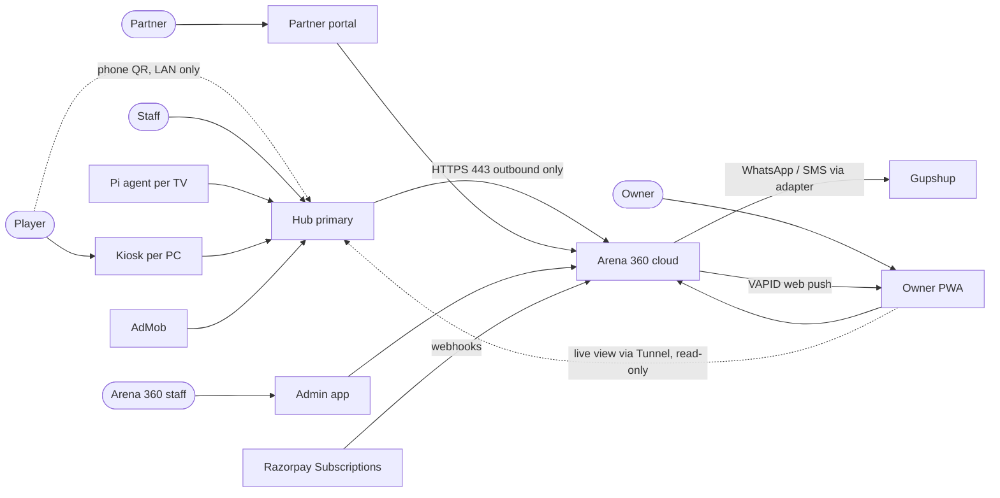
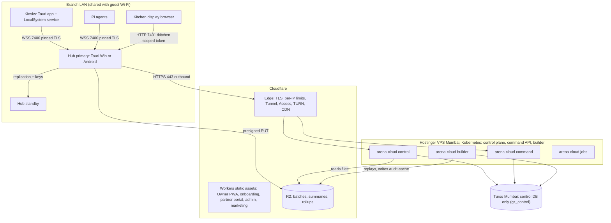
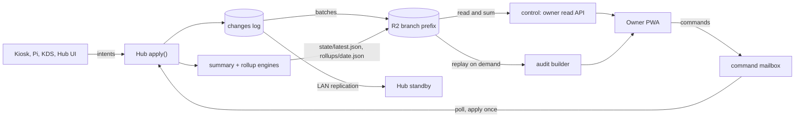

# Arena 360 — High-Level Design

Oct 23, 2026 · @Harish

> **Revision 23 Oct 2026.** Brought in line with the architecture spine (`_bmad-output/planning-artifacts/architecture/architecture-arena-360-final-2026-10-23/ARCHITECTURE-SPINE.md`), which is the binding contract; where this document and the spine differ, the spine wins. Major changes: no continuous cloud mirror — the cloud is files, a command mailbox, the licence and an on-demand audit builder, and owner reporting reads Hub-computed `state/latest.json` and daily rollups on R2; Turso holds only the control DB (`gz_control`, Mumbai); control plane on the existing Hostinger VPS in Mumbai running Kubernetes; epochs `(counter, hub_instance_id)` issued by the cloud, manual-only promotion with force promote under epoch fencing; Tauri 2 everywhere incl. the Android Hub (AdMob via an in-house Kotlin plugin); Svelte 5 + SvelteKit 3.1 for every app surface and Astro 7 for marketing, all web apps on Cloudflare Workers static assets; Owner app is a SvelteKit PWA with VAPID web push; no branch payment integration (UPI/card recorded by reference, last 4 digits); Free Hub ads = banner + interstitial on idle return only, no ads on Kiosk or Pi TV; kiosk login username + password or staff-start; Pi has no player login; notifications drained from a Hub outbox and sent by the cloud through a Gupshup adapter; crypto-shredding for player PII; yearly GST archive kept 8 years; multi-currency in minor units; per-branch Razorpay subscriptions; partner portal and internal admin app; LAN client classes; cost model updated.

> **Revision 23 Oct 2026, epics.** Decisions made during epics creation: root domain `arena360.cloud` (site, `partners.`, `admin.`, `staging.`, `api.`, `app.`, tunnel hostnames `<branch_id>.tunnel.arena360.cloud`; LAN mDNS `arena360.local` unchanged); Hub `:7401` serves TLS for paired Tauri apps and plain HTTP by path (`/kitchen`, `/console`) with scoped tokens; Free Hub ads = standard AdMob interstitial on idle return at most once per 15 min (Google controls close timing) plus a banner in a permanent reserved bottom slot, owner ad control = per-branch content rating G/PG/T (default PG); device-health telemetry stored outside `apply()`/change log; scheduled owner reports by WhatsApp only; branch KEK escrowed (wrapped) on every tier incl. Free; controller check on Hub console tiles (MVP, independent of the Pi); KOT shows seat only; smart plugs (Tuya/Tapo) deferred; rollup schema v2 (Epic 13) and v3 (Epic 14) pinned per tier; ts-rs type generation; Pi TV screens = Chromium kiosk + Svelte page served by the Pi agent; setup-file upload on paid tiers only.

## Purpose and scope

This is the high-level design for Arena 360: what the system is made of, where each part runs, how data moves, and the qualities it must have. It is the document an engineering lead reads before the low-level design and the one a new engineer reads first. Binding decisions live in the architecture spine; schemas, APIs and protocols live in "Arena 360 — Low-Level Design"; features live in "Arena 360 — Product Requirements"; the eight flows it must serve live in "Arena360 — User Journeys".

**Decisions this design is built on**

| Decision | Choice | Why |
| --- | --- | --- |
| Where the truth lives | In the branch, in one Hub's SQLite | A cafe must run with the internet down; one writer removes merge logic for money |
| What the cloud does | Files, mailbox, licence (plus an on-demand audit builder); no mirror of branch data | Owner visibility and commands without the branch depending on it, and no standing per-branch cloud compute or database |
| Owner reporting | Hub computes a summary (`state/latest.json`) and daily rollups; the cloud only reads and sums files | Hub and cloud totals can never disagree; adding a report field needs no cloud deploy |
| Sync mechanism | Append-only change log shipped in batches | One serializer feeds backups, the standby and the audit builder |
| Multi-writer | None inside a branch; primary/standby with a cloud-fenced epoch `(counter, hub_instance_id)`; promotion manual only | CRDTs cannot protect wallet and stock invariants; fencing makes a force promote safe |
| Cloud platform | Cloudflare edge + Kubernetes on the existing Hostinger VPS in Mumbai + Turso (`gz_control` only, Mumbai) + R2 | Zero egress, a prepaid node, control-plane data residency in India |
| UI stack | Svelte 5 + SvelteKit 3.1 on every app surface; Astro 7 for the marketing site; one shared token and component package | One UI codebase across Kiosk, Hub (Windows and Android), Kitchen display, Owner PWA, portals |
| Free tier | Android Hub (Tauri 2 mobile) with an AdMob banner in a reserved bottom slot + standard interstitial on idle return (≤ once/15 min) (revised 23 Oct 2026, epics); Windows Hub for paid | Ads need a mobile ad SDK; Free costs the company nothing |
| Connectivity beyond LAN | Cloudflare Tunnel first; WebRTC only Hub-to-Hub | Tunnel is free and needs no NAT code; TURN reserved for off-site standby |
| Billing | Razorpay Subscriptions only, one subscription per branch, autopay mandatory (card or eNACH above ₹15,000) | One integration; recurring revenue by default; renewals stay under the UPI Autopay ceiling |
| Counter payments | Cash, UPI and card recorded by reference (UPI last 4 digits); no branch payment provider | No provider keys or webhooks at the branch this phase |
| Kiosk and Windows Hub platform | Windows 10+, Tauri 2 (Rust core + WebView2) | One Rust toolchain shared with the Hub |

**Out of scope here**: UI design (see the Arena 360 design system), accounting exports, player mobile app, cloud gaming, arbitrary SQL reporting in the cloud over branch data (reports are defined rollup fields).

## System context

Arena 360 sits between the people in a cafe and five outside services. Everything a player or staff member does stays inside the branch; only the owner, billing, messaging, push and ads cross the internet.

| Relationship | Direction | Channel | Fails how |
| --- | --- | --- | --- |
| Owner ↔ Arena 360 | Both | Owner PWA over HTTPS to the cloud `/v1` API (reads Hub-computed files, writes commands); premium read-only live view through a Tunnel to the Hub | Owner sees the last figures with their `as_of`; branch unaffected |
| Staff ↔ Hub | Both | Hub UI on LAN | Standby promote; nothing leaves the LAN |
| Player ↔ Kiosk, Pi | Both | Kiosk and Pi over LAN WebSocket to the Hub; phone QR page served by the Hub on the LAN (console request + own timer only) | Kiosk keeps a local countdown and locks at time-up; game keeps running |
| Partner → Arena 360 | Both | Referral code at tenant sign-up; partner portal for referral and payout summaries | None at runtime |
| Arena 360 staff → Arena 360 | In | Admin app behind Cloudflare Access (catalogue, partners, refunds, support) | Curation waits; branches unaffected |
| Arena 360 ↔ Razorpay | Both | Subscriptions and webhooks from the cloud only | Subscriptions retry; branch unaffected |
| Arena 360 → Gupshup | Out | Cloud sends WhatsApp and SMS from Arena 360's account on the Hub's behalf (drained from the Hub outbox) | Messages wait in the outbox and send later |
| Arena 360 → Owner device | Out | Standard Web Push (VAPID) from the cloud | Alert shows on next open; WhatsApp stays primary for critical alerts |
| AdMob → Android Hub | In | Google Mobile Ads SDK in the Free-tier Android Hub only | No ad shown; no effect on operations |
| Kiosk ↔ Launchers | Both | Local process control on each PC | Launch fails visibly; logout still enforced |

## Component view

Sixteen components in three places. Only the Hub primary writes branch data; the cloud writes only its own control tables and the R2 objects it owns (audit caches, catalogue media).

| Component | Runs | Responsibility | Owns data | Provides | Consumes |
| --- | --- | --- | --- | --- | --- |
| Hub primary | Branch counter PC (Windows, Tauri 2) or tablet (Android, Tauri 2 mobile, Free) | Sessions, players, wallets, POS, inventory, kitchen, shifts, RBAC, floor view; the single writer; change log; lease; summary and rollup engines; notification outbox | Branch SQLite, player key table, reference cache (catalogue, media, licence) | LAN WebSocket API `:7400`, HTTPS/HTTP `:7401`, `/replicate` | Control plane HTTP, R2 presigned PUT, command mailbox |
| Hub standby | Second branch PC | Replays the change log and player keys; manually promotable; keeps its own reference cache | Replica SQLite | Promote UI | `/replicate` from primary |
| Kiosk | Each gaming PC | Lockdown, username + password login or staff-start, HUD, orders (Basic+), game library from the global catalogue, launcher logout, booster | Device token only | — | Hub LAN API (pinned TLS) |
| Pi controller | Raspberry Pi per console TV | QR idle screen, CEC input switching, warnings, lock screen (Chromium kiosk showing a Svelte page served by the Pi agent); no player login (revised 23 Oct 2026, epics) | Device token only | — | Hub LAN API (pinned TLS) |
| Hub UI | Tauri window on the Hub device | Staff interface | — | — | Hub core in-process |
| Kitchen display | Tablet browser on LAN | KOT queue and status | Scoped pairing token | — | Hub `:7401` `/kitchen` (plain HTTP/WS, kitchen scope) (revised 23 Oct 2026, epics) |
| Phone console page | Player's phone browser on LAN | Request a console plan, show own live timer | Short-lived per-console token | — | Hub `:7401` `/console` (plain HTTP, rate-limited per TV; QR via `arena360.local` mDNS) (revised 23 Oct 2026, epics) |
| Control plane | `arena-cloud` role `control`, K8s on Hostinger VPS Mumbai | Tenants, owners, auth, subscriptions, licence, pairing, devices, branch fence, heartbeat and gap detection, presign, owner read API, notify send, web push, catalogue, partners, signaling | `gz_control` (Turso) | Hub API, Owner/partner/admin `/v1` API, webhooks | Razorpay, Gupshup, Cloudflare API, R2 |
| Command relay | `arena-cloud` role `command` | Owner/admin commands, fan-out per branch, status, expiry, epoch checks | `commands` in `gz_control` | Owner API, Hub poll endpoint | `branch_fence` |
| Audit builder | `arena-cloud` role `builder` | Replays snapshot + a month of batches into a temporary SQLite for audit queries | `builder_jobs`; `audit-cache/` objects (24 h) | Audit API | R2 |
| Jobs | `arena-cloud` role `jobs` | Command sweeper, partner payouts, branch-offline alerts, retention | — | — | `gz_control`, R2 |
| Edge | Cloudflare | TLS, DDoS, per-IP rate limits, Tunnel hostnames with Access, TURN, CDN for catalogue media, Workers static assets | — | Hostnames, TURN credentials | Hub tunnels |
| Owner app | SvelteKit PWA on Workers static assets (phone and desktop) | Dashboards, alerts, commands, billing, MFA, audit, live view | — | — | Owner API, Hub via Tunnel (premium) |
| Marketing and onboarding | Astro site + SvelteKit onboarding on Workers static assets | Site, pricing, sign-up with referral capture, onboarding wizard | — | — | Control plane |
| Partner portal | SvelteKit on Workers static assets | Referral and payout summaries for partners | — | — | Control plane (partner scope) |
| Admin app | SvelteKit on Workers static assets behind Cloudflare Access | Global game catalogue curation, partner approval/KYC/payout marking, refunds, support | — | — | Control plane (admin scope, audited) |

**Interfaces that matter**

| Interface | Style | Direction | Notes |
| --- | --- | --- | --- |
| Hub LAN protocol | WebSocket, JSON frames `{v, kind, rid}` | Devices → Hub | Every intent is a request; the Hub pushes session events; first frame `hello{credential, class, versions, capabilities}` |
| LAN client classes | Device token over TLS pinned to the Hub cert; scoped tokens over plain HTTP | Devices → Hub | Paired apps (kiosk, Pi, standby) use pinned TLS; kitchen display and phone page use scoped tokens on plain HTTP (accepted risk) |
| Hub → cloud | HTTPS, bearer device token + licence | Hub initiates all | Heartbeat (gap detection, fence, cloud time, licence), presign, commands, results, notify; idempotent |
| Hub → R2 | HTTPS presigned PUT | Hub → R2 | Change-log batches, `state/latest.json`, daily rollups, snapshots, GST archive, player-key backup |
| Replication | WebSocket | Primary → standby | Same batch format as the cloud upload, plus the player key table |
| Owner API | HTTPS `/v1`, session cookie + MFA | Owner PWA → cloud | Reads Hub-computed files (`/live`, `/summary?range=`), audit via builder, writes commands |
| Tunnel | Cloudflare Tunnel + Access | Owner PWA → Hub | Premium live view, read-only; cloud-signed token (≤ 5 min) verified by the Hub |
| WebRTC | Data channel over STUN/TURN | Hub ↔ Hub | Off-site standby only; cloud is signaling |

## Deployment view

The whole fleet is served by Kubernetes workloads on one prepaid VPS in Mumbai behind Cloudflare, with Turso and R2 as managed stores; every branch is a self-contained island of PCs on its own LAN that only ever makes outbound connections.

| Node | Hosting | Sizing at launch | Scales by |
| --- | --- | --- | --- |
| Cloudflare Workers static assets | Managed | Free | — |
| Cloudflare edge (DNS, TLS, per-IP rate limits, Tunnel, Access, TURN, CDN) | Managed | Free plus TURN usage | Usage |
| VPS | Existing Hostinger VPS, Mumbai (3-year prepaid), running Kubernetes | One node; `arena-cloud` roles control, command, builder and jobs as K8s workloads | A second node for the builder when queue depth or the audit first-query NFR demands it |
| Turso | Managed, Mumbai region | `gz_control` only; Free plan | Free → Scaler, control only |
| R2 | Managed | Free to 10 GB | Usage |
| Hub primary | Cafe's counter PC (Windows 10+) or Android tablet (Free, Android 9+, 3 GB) | Rust Hub service < 50 MB RAM idle; Hub UI (WebView2) < 250 MB | One per branch |
| Hub standby | Cafe's second PC | Same binary | Optional, paid |
| Gaming PCs | Cafe's PCs, Windows 10 1803+ | Kiosk app, Tauri, < 80 MB | Up to the tier's device cap |
| Pi per TV | Pi Zero 2 W or Pi 4 | Pi agent | One per console TV |
| Kitchen tablet | Any browser on LAN | — | — |

**Network rules.** The Hub opens no inbound ports to the internet. Outbound from the branch is HTTPS 443 only: heartbeat, presigned PUTs to R2, command polling, notification drain and, where the `tunnel` flag is on, the `cloudflared` tunnel. The branch LAN is the guest Wi-Fi, so the Hub authenticates every LAN client by class: paired devices with a device token over TLS pinned to the Hub certificate, the kitchen display with a scoped pairing token, and the anonymous phone page with a short-lived per-console token limited to a console request and its own timer. Port `:7401` serves both TLS (paired Tauri apps, pinned cert) and plain HTTP by path (`/kitchen` board, `/console` phone page) with scoped tokens (revised 23 Oct 2026, epics). The owner's live view reaches the Hub through the tunnel hostname `<branch_id>.tunnel.arena360.cloud` behind Cloudflare Access. Hub-to-Hub replication across sites uses a WebRTC data channel negotiated through the control plane, STUN first and TURN as fallback.

**Regions.** The control plane and `gz_control` live in Mumbai, so control-plane data stays in India; branches talk to it through Cloudflare's anycast edge, which keeps latency acceptable because every branch call is a background task, never on a player's critical path. Markets at launch are India plus the countries Razorpay Subscriptions can bill.

## Data architecture

Every row of branch data has exactly one owner, the Hub primary. The cloud keeps no copy of branch rows: it holds the files the Hub ships (batches, summary, rollups, snapshots, GST archive), its own control data, and audit caches it can rebuild from those files on demand. The loop closes through the same `apply()` the kiosk uses, so an owner command is just another intent.

The standby replays the same batches over LAN that the uploader ships to R2, and the audit builder replays them in the cloud; one serializer, one replayer (`arena-replay`).

**Stores and ownership**

| Store | Where | Owner | Contains | Rebuildable from |
| --- | --- | --- | --- | --- |
| Branch SQLite | Hub primary | Hub | Domain tables, `changes`, `lease`, `rollup_log`, device registry, licence cache; player key table (outside the change log); reference cache (catalogue, media) | R2 snapshot + batches + `keys/player-keys.bin` |
| Replica SQLite | Hub standby | Standby (read-only until promoted) | Same schema, player keys, its own reference cache | Primary |
| R2 branch prefix | Cloudflare | Hub writes; cloud reads | `tenants/<t>/branches/<b>/`: `changes/`, `snapshots/`, `state/latest.json`, `rollups/`, `gst-archive/<fy>.zst`, `audit-cache/` (builder, 24 h), `keys/player-keys.bin` | Source of truth for history |
| R2 shared | Cloudflare | Cloud | Catalogue media behind the CDN, signed Kiosk/Hub/Pi installers | Admin app uploads, CI |
| `gz_control` | Turso, Mumbai | Control plane | Tenants, owners, branches, licences, `branch_fence`, `commands`, `builder_jobs`, subscriptions, partners and payouts, global game catalogue, rate limits, send ledger, push subscriptions, admin audit | Nightly off-provider backup |
| Owner app cache | Browser (IndexedDB, service worker) | Owner PWA | Last figures with `as_of`, queued commands | Owner API |

**Rules**

1. Money is integer minor units of the branch currency (ISO 4217 code on the branch); time is unix milliseconds in UTC; `apply()` stamps `business_day` and `fy` on every session, money row and invoice; ids are ULIDs minted by the writer, so rows stay unique across branches.
2. The change log is append-only and gap-free per epoch; a new epoch's first batch declares its fork point; a reader detects loss by sequence number, never by timestamp. Gaps are found by the heartbeat and repaired by a `resend` range.
3. Owner figures come only from Hub-computed files and say how old they are: summaries carry `as_of`; rollups are schema-versioned and regenerable by the Hub. The cloud never recomputes branch figures from rows.
4. Commands and offline-queued intents carry a client ULID idempotency key; the Hub applies each once and records it in the same transaction; commands expire after 7 days.
5. Player PII (name, phone) is encrypted at the Hub with a per-player key held outside the change log; erasure deletes the key (crypto-shredding), so batches, snapshots and audit caches only ever hold ciphertext. No card data anywhere.
6. Retention: branch `changes` pruned 90 days after upload; batches, snapshots and rollups kept 1 year (Basic) or 3 years (Premium); a yearly GST archive (invoices, credit notes, tax summaries) kept 8 years on every paid tier; GST money records kept 8 years in the Hub DB. Free uploads nothing under the branch prefix; the branch KEK escrowed (wrapped) in `gz_control` on every tier incl. Free is the single key-only exception, like licence and heartbeat, and the setup-file template upload is paid tiers only (revised 23 Oct 2026, epics).

**Backup and restore.** The Hub primary writes a daily snapshot after close. A branch is restored from the latest snapshot plus every batch since and the player-key backup, replayed by the same replayer, and the restored Hub opens a new epoch (same fencing as a promote). Full DB export is available on every tier. Restore is tested by the onboarding wizard's "restore drill" on paid tiers once a quarter.

## Integrations

Seven outside integrations, each behind one adapter module with a recorded fake and a manual mode, so a provider can be swapped without touching domain code. None of them sits on a player's critical path.

| Integration | Used for | Called from | Protocol | Offline behaviour | Secrets live |
| --- | --- | --- | --- | --- | --- |
| Razorpay Subscriptions | Per-branch tenant billing, monthly and yearly plans, autopay mandates (UPI Autopay up to ₹15,000; card or eNACH above), refunds | Control plane | REST + webhooks (signature verified, idempotent by event id) | N/A (cloud) | SOPS + age encrypted, decrypted into K8s secrets at deploy |
| Gupshup | WhatsApp receipts, credit reminders, session alerts; SMS fallback; owner OTP | Control plane, from Arena 360's account, on the Hub's behalf (drained from the Hub outbox) | REST, templates pre-approved; behind a swappable messaging adapter | Requests wait in the Hub outbox and send when the branch is back online | SOPS + age |
| Web Push (VAPID) | Owner alerts to the Owner PWA | Control plane | Standard Web Push | Alert waits for the browser; WhatsApp stays primary for critical alerts | SOPS + age |
| AdMob | Banner (always, in a permanent reserved bottom slot) and the standard AdMob interstitial on idle return at most once per 15 min (Google controls close timing) on the Free Android Hub; owner sets a per-branch content rating G/PG/T (default PG, MA never); never on Kiosk or Pi TV (revised 23 Oct 2026, epics) | Android Hub, via an in-house Tauri Kotlin plugin | Google Mobile Ads SDK | No ad shown; app continues | App id in build config |
| Cloudflare Tunnel + Access | Owner live view (premium or add-on), read-only | Hub spawns `cloudflared` | Outbound tunnel; Access service tokens | Live view unavailable; LAN unaffected | Tunnel token delivered per heartbeat |
| Cloudflare TURN | Off-site standby replication fallback | Hub | ICE credentials from control plane | Replication pauses; resumes from last seq | Short-lived credentials |
| ESC/POS printers, cash drawer, barcode scanner, HDMI-CEC | Receipts, KOT (seat — PC/TV number or 'Counter' — only, no player name, no cancel slip) (revised 23 Oct 2026, epics), drawer kick, scanning, console control | Hub and Pi (after commit, from a local outbox) | USB, LAN 9100, Bluetooth SPP; CEC via `cec-client` | Printer offline shows a badge; kitchen display still works | None |

Counter UPI and card payments are not an integration this phase: staff record them by reference (UPI requires the last 4 digits), with no provider keys or webhooks at the branch.

**Integration principles**

- The Hub never holds a tenant-wide secret; every key it has is scoped to its branch and revocable.
- Webhooks land in the cloud only; anything a branch needs to know arrives as a command or in the licence, so the Hub has a single inbound channel to reason about.
- Each adapter has a recorded fake for tests and a "manual" mode for the counter, so a provider outage degrades to a human step, never a blocked sale.

## Technology stack

Two languages for the whole system: Rust for everything that holds data, and TypeScript with Svelte for every screen. The Kiosk and both Hubs are Tauri 2, so their core is the same Rust; protocol types are generated from Rust into the shared UI package with ts-rs (revised 23 Oct 2026, epics).

| Component | Language, framework | Key libraries | Why |
| --- | --- | --- | --- |
| Hub (Windows) | Rust, Tauri 2.12, Axum, Tokio | rusqlite (WAL), tokio-tungstenite, zstd, rmp-serde, mdns-sd, ed25519-dalek, reqwest, aws-sdk-s3 (presigned PUT) | Rust Hub service < 50 MB idle, same codebase as the cloud |
| Hub (Android, Free) | Rust core in Tauri 2 mobile; same Svelte UI | In-house Tauri Kotlin plugin calling Google Mobile Ads SDK 25.5.x; Android plugins for foreground service, mDNS and Bluetooth printing; targetSdk 36, minSdk 28 | One Hub codebase across Windows and Android; no ad code in Rust |
| Hub UI | Svelte 5.57, SvelteKit 3.1 (`adapter-static`), TypeScript 6, Vite 8 | Shared UI package (tokens from DESIGN.md, components, message catalogue, generated types); Sora bundled | Small bundle for old counter PCs; no runtime font or CDN fetch |
| Kiosk | Rust, Tauri 2, Svelte front end in WebView2 | tokio-tungstenite, windows crate for hooks and process control, windows-service, Tauri updater | Shares arena-proto and cleaners with the Hub; Windows 10 1803+ only |
| Pi agent | Rust (aarch64) | cec-client bindings; TV screens rendered by Chromium in kiosk mode showing a Svelte page served by the Pi agent, using the shared tokens and components (revised 23 Oct 2026, epics) | Same crate family; low RAM |
| Kitchen display | Web page served by Hub | Svelte | Any tablet, no install |
| Cloud (control, command, builder, jobs) | Rust, Axum, Tokio; one binary, four roles, on Kubernetes | libsql 0.10 (`gz_control` only), aws-sdk-s3 for R2, jsonwebtoken (EdDSA), argon2, web-push (VAPID) | One binary; the builder reuses `arena-replay` |
| Owner app | SvelteKit 3.1 PWA (`adapter-cloudflare`) | Service worker, IndexedDB cache, Web Push | One codebase for phone and desktop; installable |
| Partner portal, admin, onboarding | SvelteKit 3.1 on Workers static assets | Shared UI package | Same stack as the Owner PWA |
| Marketing | Astro 7.4 + @astrojs/svelte 9.1 on Workers static assets | Shared Svelte components | Static, free, fast in every region |
| Data | SQLite (branch, builder temp DBs), Turso/libSQL (`gz_control`), R2 files | — | Same SQL dialect end to end |
| Secrets | SOPS 3.13 + age 1.3 in repo; OS keystore on devices (DPAPI, Android Keystore) | — | No plaintext secrets on the VPS or disk |
| Observability | OpenTelemetry to Grafana Cloud; Hub diagnostics bundle; Sentry for crashes | opentelemetry 0.33, sentry 0.49 | Cheap, standard |
| Build and release | GitHub Actions; cargo, Tauri CLI 2.12, Node 22.23.4+ for all web builds; code signing for Windows (Authenticode) and Android (Play) | — | Staged rollout from control plane and Play |

## Non-functional requirements

The branch is held to real-time standards; the cloud is held to "eventually, and honest about it".

| Quality | Target | Where measured | How the design meets it |
| --- | --- | --- | --- |
| Availability (branch) | Sessions and sales work 100% of open hours with WAN down; Hub PC failure recovered in under 10 s with a standby (from promote confirmation to first accepted intent) | 8-hour offline soak, failover drill | Local-first, single writer, lease and fenced epoch |
| Availability (cloud) | 99.5% monthly for Owner API; branch never depends on it | Uptime checks | Hub uploads direct to R2; branches unaffected by a cloud outage; DR rebuild from code, RTO 4 h |
| Latency (LAN) | Session start, sale, end under 100 ms server-side, under 2 s end to end including kiosk unlock; floor state ≤ 2 s; KOT ≤ 3 s; console switch ≤ 3 s | Hub timing logs | SQLite WAL, in-process, no network hops; LAN state pushed over WS |
| Latency (owner) | Dashboard under 2 s from files; data age ≤ cadence (Basic ≤ 15 min, Premium ≤ 5 min or live) for 99% of opens; command delivery p95 < 2 min when the branch is online; audit first query < 10 s with a progress state | Owner API traces | File reads with 30 s cache and ETag; 60 s poll plus poke; on-demand builder with 24 h cache |
| Reporting compute | Summary < 50 ms; rollup at close < 5 s on reference hardware and on a 3 GB Android device | CI benchmark | Rollups computed from stamped columns and stored invoice totals |
| Data loss | Zero committed transactions lost on Hub crash; at most one upload interval lost on disk failure without standby | Crash tests, restore drills | WAL, fsync on commit, batched uploads, daily snapshots |
| Consistency | Wallet and stock never negative; one active session per device; Owner API sum-of-rollups equals Hub Z-report totals | Property tests on `apply`; 30-day synthetic comparison | Invariants inside one transaction; one computation path for figures |
| Throughput | 60 devices per Hub, 5 intents per second sustained, 50 per second burst | Load test on a 2015 PC | Thousands of SQLite tx/s available |
| Footprint | Rust Hub service idle under 50 MB RAM, Hub UI (WebView2) under 250 MB, Kiosk under 80 MB, no GPU use | Reference hardware benchmark per release | Rust service; separate UI budget |
| Cost | Under ₹10 per paid branch per month on average (≈ ₹6 Basic, ≈ ₹12 Premium); free tenant ≈ ₹0 | Cloud bills | No mirror, no per-tenant compute; upload cadence is the cost lever (30 s floor) |
| Security | No inbound internet ports on Hub; every device token revocable within one heartbeat; signed entitlements | Pen test before GA | See Security |
| Compatibility | Kiosk on Windows 10 1803 to 11; Hub on Windows 10+ and Android 9+ (3 GB RAM); any ESC/POS printer | Compatibility matrix | Tauri; Rust; raw ESC/POS |
| Offline duration | Unlimited for Free; paid features resume after any outage; licence cached 7 days against trusted time | Soak test | Change-log cursors, heartbeat gap repair, cached JWT, `trusted_now` |
| Upgrade safety | Hub and Kiosk updates never during an open session; standby updates before primary; rollback is a roll-forward hotfix | Release checklist | Staged rollout flags from control plane; Play staged rollout |
| Localisation | UI strings externalised in one message catalogue; number, date and currency by locale; currency per branch (ISO 4217) | Build check (lint on hard-coded strings) | i18n from day one |
| Observability | Every write traceable to a typed actor; diagnostics bundle under 5 MB; cloud traces with tenant id | Audit via builder, support tooling | Change log is the audit log |

## Security architecture

Trust is per device and per branch. Nothing in the system accepts an unauthenticated write, and nothing a branch holds can reach another branch's data.

| Layer | Control | Detail |
| --- | --- | --- |
| Identity | Owner accounts with password + TOTP + backup codes (OTP by SMS as fallback); staff accounts with password + PIN on the Hub; players log in at the kiosk with username + password (Argon2id at the Hub) or staff start the session; devices with 256-bit tokens | Owner step-up MFA for sensitive commands; staff PIN elevates inside the sheet; staff credentials never travel in commands (one-time setup code) |
| Device trust | Pairing codes (single use, short expiry) exchanged for tokens; argon2 hashes stored, plaintext only in the OS keystore | Revocation from Owner app or Hub takes effect within one heartbeat or immediately on LAN |
| Authorisation | RBAC permission catalogue checked inside `apply`; every intent maps to one permission; change rows record a typed actor and `elevated_by` | A kiosk token cannot perform staff actions regardless of what it sends |
| Entitlement | EdDSA-signed JWT, 7-day expiry, verify keys embedded in Hub; expiry evaluated against trusted time (cloud time + monotonic elapsed) | Tampering produces a signature failure and Free-tier behaviour; wall-clock skew > 5 min alerts staff |
| Network | Hub outbound-only on 443; paired LAN apps use TLS pinned to the Hub cert; kitchen display and phone page use plain HTTP with scoped tokens; Tunnel behind Cloudflare Access; TURN credentials one hour | The LAN is the guest Wi-Fi; client classes limit what each can do; KDS and phone traffic readable on the LAN is an accepted risk |
| Data | Player PII encrypted per player and erased by deleting the key (crypto-shredding); R2 encrypted at rest; presigned URLs scoped to one key; whole-DB SQLCipher deferred | No card data anywhere; Razorpay tokenises |
| Secrets | Cloud secrets SOPS + age encrypted in repo, decrypted into K8s secrets at deploy; device tokens and branch KEK in DPAPI / Android Keystore | Never plain VPS env files |
| Isolation | Per-branch R2 prefix; presigned URLs scoped to that prefix; the owner API enforces the tenant on every object key, with tenant and branch scope taken from the session on every API call; partners see only referral and billing summaries | A compromised Hub can read and write only its own prefix |
| Audit | `changes.actor{kind, id}`, `intent_id` and `elevated_by` on every row; admin actions audited in `gz_control`; owner audit via the builder | Audit is the change log, not a second system |
| Supply chain | Signed Windows (Authenticode + Tauri updater ed25519) and Android (Play) builds; Hub verifies Kiosk and Pi update signatures before serving them on LAN | Staged rollout; roll-forward hotfix |
| Abuse | Cloudflare per-IP limits on public and auth endpoints; per-tenant limits in `arena-cloud`; pairing 5 attempts per code and 20 per IP per hour; kiosk login lockout; phone page rate-limited per TV; AdMob policy compliance on the Free Hub | Alerts to the owner on repeated failures |

Threats explicitly out of scope: a cafe owner defrauding their own staff (the system records, it does not police) and physical theft of the counter PC (whole-DB encryption is deferred; player PII is already encrypted).

## Scalability and capacity

The design scales by adding tenants, not by making anything bigger: each branch brings its own compute and computes its own reports, and the cloud's work per paid branch is a few PUTs per upload interval, a heartbeat and the occasional audit build.

| Scale | Branches | Cloud load per day | VPS | Turso | R2 | Monthly cloud cost |
| --- | --- | --- | --- | --- | --- | --- |
| Launch | 1–100 | Batch + summary PUTs at tier cadence, heartbeats | Existing Hostinger node, idle | Free plan, one DB | Free tier | under ₹1,000 beyond the prepaid VPS |
| 1,000 tenants (half paid) | 1,000 | As above × 500 paid branches; Free sends heartbeats and ad impressions only | One node | Free plan, one DB | Low GB | ≈ ₹7,000 |
| 10,000 tenants | 10,000 | Scales with paid branches and cadence | One node; builder on a second node when queue depth demands | Scaler | Linear in paid branches | ≈ ₹6 Basic / ₹12 Premium per paid branch |
| 1,000,000 branches | 1,000,000 | Batch + summary PUTs ≈ 60% of cost | Builder and control scaled out as K8s workloads | ≈ $45 (control DB only) | Linear, bounded by retention | ≈ ₹64 lakh |

**What scales and how**

- **Hub**: fixed per branch; 60 devices and 5 intents/s are far below SQLite's ceiling. The only per-branch growth is the change log, pruned at 90 days; reports are computed on the Hub.
- **VPS**: the control and command roles are plain request handlers over `gz_control` and R2; the builder is the only heavy role, bounded by a 24 h audit cache and a 50 GB local LRU, and moves to a second node first.
- **Turso**: one control database whose size grows with tenants and commands, not with branch activity.
- **R2**: object storage; growth is linear in paid branches and bounded by tier retention; the largest cost line is batch + summary PUTs, so upload cadence (Basic 900 s, Premium 300 s, 30 s floor) is the main lever.
- **Owner API**: sums small rollup files in memory with a 30 s cache and ETag checks; never queries branch rows.
- **Ads (Free)**: served by AdMob, so impression volume never touches the VPS beyond aggregated impression rows.

**Where the design does not scale and that is deliberate**: live owner views are served by each Hub through its tunnel, never by cloud compute, and audits are built only on request, so there is no per-tenant always-on process or database anywhere.

## Environments, CI/CD and rollout

Three environments, one deploy pipeline, and a rollout that treats the branch fleet as the thing that must never break.

| Environment | Cloud | Branch software | Data | Purpose |
| --- | --- | --- | --- | --- |
| dev | Each engineer's local Rust binary with SQLite in place of Turso and MinIO in place of R2 | Hub and Kiosk against a local Hub on the same machine or VM | Seeded demo tenant | Daily work |
| staging | Separate K8s namespace or node, Turso org and R2 bucket; `api.staging.arena360.cloud` | Internal test cafe with 10 PCs, a Pi and a printer; two friendly beta cafes | Anonymised copy of production control data; synthetic branch data; no ingester; the builder is tested with a synthetic month | Release candidate soak, failover and restore drills |
| production | K8s on the Hostinger VPS behind Cloudflare; `api.arena360.cloud` | The fleet | Real | — |

**Pipeline** (GitHub Actions): lint and unit tests on every push; property tests for `apply` invariants; rollup golden tests; generated-type freshness check; integration tests that run a Hub, a fake Kiosk and the cloud binary together; builder round-trip checksum equals the Hub DB; Owner API sum-of-rollups equals Hub Z-report totals over 30 synthetic days; signed Windows and Android builds; web builds for the Owner PWA, portals and marketing; release candidate to staging on tag.

**Rollout order on a release**: a Hub release carries any rollup schema bump; cloud first (must accept rollup schema N and N−1 and every command schema the field supports), then standby before primary, Windows Hub to 1% of branches by control-plane flag, 10%, 50%, 100% over a week, Android Hub by Play staged rollout, then Kiosk and Pi served through each Hub's signed cache. Hub updates install on restart only when no session is active; Kiosk updates between sessions. Rollback is a roll-forward hotfix; schemas migrate forward only with additive changes until the fleet has caught up.

**Compatibility contract**: a Hub must accept any Kiosk from the previous two releases; the cloud emits only command versions a branch reports it supports (else `BRANCH_UPDATE_REQUIRED`); unknown message kinds return `UNSUPPORTED` rather than failing.

**Operations**: cloud metrics and traces to Grafana Cloud, crashes to Sentry; alerts on summary age per branch, rollup missing-day count, builder queue depth, command backlog, webhook failures, and heartbeat gaps across many branches at once (a cloud problem, not a cafe problem). A tenant-facing job alerts the owner when a branch sends no heartbeat for 30 minutes during opening hours. Support uses the Hub's diagnostics bundle and the audit builder with a recorded reason, never direct access to a branch.

## Journey-to-component traceability

Every one of the eight user journeys is served by the components below; the column "must not fail" names the single component or link each journey depends on most.

| Journey | Hub | Kiosk | Pi | Owner app | Control plane | R2 files + builder | Command relay | Edge | Must not fail |
| --- | --- | --- | --- | --- | --- | --- | --- | --- | --- |
| 1 Owner onboarding | ● | ● | ○ | ● | ● | — | ○ (`branch.bootstrap`) | Workers | Pairing: control plane → Hub |
| 2 Walk-in postpaid | ● | ● | — | — | — | — | — | — | Hub `apply` and LAN |
| 3 Prepaid at kiosk | ● | ● | — | — | — | — | — | — | Kiosk HUD ↔ Hub |
| 4 Order to kitchen | ● | ● | — | — | — | — | — | — | Hub → printer / display |
| 5 Shift close | ● | — | — | ○ | ○ | ○ (next summary + day rollup) | — | — | Expected-cash arithmetic in Hub |
| 6 Remote price change | ● | ○ | — | ● | ● | ○ (next `state/latest.json`) | ● | — | Command idempotency on Hub |
| 7 Credit player | ● | ● | — | ○ | ● (Gupshup) | ○ | ○ | — | Limit check inside `apply` |
| 8 Hub failover | ● (standby) | ● | ○ | — | ○ (epoch fence) | ○ | — | — | Lease epoch and mDNS re-resolve |

● primary participant · ○ secondary or later · — not involved

The table makes the priority order concrete: journeys 2, 3 and 4 depend only on the Hub, Kiosk and LAN, which is why the branch stack is built and hardened first.

## Risks, mitigations and open items

| Risk | Likelihood | Impact | Mitigation | Owner |
| --- | --- | --- | --- | --- |
| Kiosk lockdown bypassed | Medium | Players reach the desktop; revenue leak | Shell replacement, hook-based key blocking, process allow-list; pen test before GA; bug bounty for cafes | Engineering |
| Split-brain after a force promote | Low | Duplicate writes during a partition | Cloud-issued epoch `(counter, hub_instance_id)` fenced in `gz_control`; epoch re-checked in every transaction; old Hub self-locks on a higher epoch; old-epoch rows above the fork orphaned, never replayed; promotion manual only | Engineering |
| R2 write costs from a bad interval | Medium if misconfigured | Many × cost per tenant | Hard floor of 30 s on `upload_interval_s`; tier cadence Basic 900 s / Premium 300 s; cost alert per tenant | Engineering |
| Rollup schema lags a report request | Medium | Owner asks for a figure the rollup lacks | Rollup schema versioned; Hub regenerates older days (oldest first, max 10/min); a new field needs only Hub + Owner app releases; the licence pins `rollup_schema` per tier and the Hub emits the pinned schema (v2 with Epic 13, v3 with Epic 14) (revised 23 Oct 2026, epics) | Engineering |
| Audit builder load spikes | Medium | Slow first audit query | 24 h audit cache, 50 GB local LRU, progress state; add a second node for the builder | Engineering |
| Single-node control plane | Medium | Owner API and commands down while rebuilt | Branches unaffected (local-first); rebuild from code + nightly off-provider `gz_control` backup, RTO 4 h | Engineering |
| Razorpay unavailable in a target country | High for some regions | Cannot sell there | Markets limited to India + Razorpay Subscriptions countries; pricing page hides others | Product |
| AdMob policy rejects the counter use case | Medium | Free tier loses funding | Ads only in the Android Hub app (banner in a reserved slot + standard interstitial on idle return at most once per 15 min, never after settle or over an open cart; content rating G/PG/T) (revised 23 Oct 2026, epics), never on PCs or TVs; review policy before Free launch | Growth |
| Gupshup template approval delays | Medium | Reminders late at launch | Submit templates at wave 1; SMS fallback; adapter swappable | Product |
| Scope: everything in one launch | High | Date slips | Wave-1 beta with 20 cafes while waves 2 and 3 are built; cut list agreed before beta | Founder |
| Gaming PCs below Windows 10 1803 cannot run the Kiosk | Medium | Onboarding friction | Stated minimums on the downloads page; partners offer OS upgrades as a service; Android Hub for old counter PCs | Product |
| Printer compatibility | Medium | Support load | Raw ESC/POS, tested-device list, "print test" in onboarding, WhatsApp receipts as a no-printer path | Engineering |

**Open items for the LLD**

- [x] Exact Access policy and service-token rotation for Tunnel hostnames
- [x] WebRTC signaling message schema for off-site standby
- [x] AdMob placement review against policy for the Android Hub
- [x] Pi image build pipeline and CEC compatibility matrix
- [ ] Rollup schema v1 field list sign-off
- [ ] Browser-class LAN TLS for the kitchen display and phone page
- [ ] Razorpay Subscriptions coverage for Malaysia, Singapore and US
