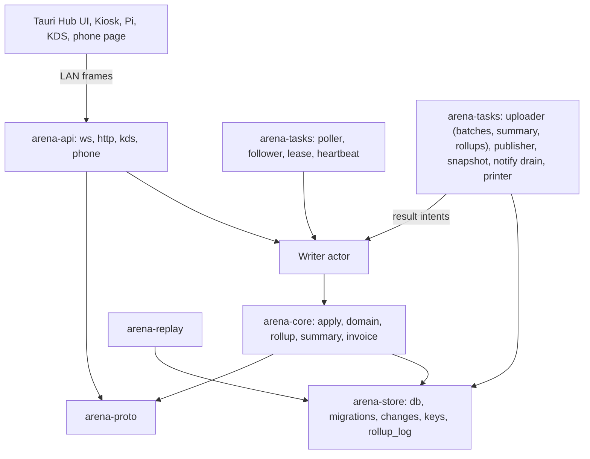

# Arena 360 — Low-Level Design

Oct 23, 2026 · @Harish

> **Revision 23 Oct 2026.** Brought in line with the architecture spine (`_bmad-output/planning-artifacts/architecture/architecture-arena-360-final-2026-10-23/ARCHITECTURE-SPINE.md`), which is the binding contract; where this document and the spine differ, the spine wins. This document now also carries the infrastructure tables, batch format and Hub↔cloud endpoints that previously lived in a separate low-level architecture document. Major changes: no cloud mirror — the uploader ships batches plus Hub-computed `state/latest.json` and daily rollups, gaps are found by heartbeat, owner reads come from files and audits from an on-demand builder; `commands` in `gz_control`; epochs `(counter, hub_instance_id)` issued by the cloud through `branch_fence`, manual-only promotion with force promote under fencing; undo as compensating intents with row versions (`rev`/`base_rev`); client ULID idempotency keys with a relay-assigned fetch cursor; `business_day`/`fy` stamped in `apply()`; money in minor units with ISO 4217 currency; epoch-segmented invoice numbering and per-invoice GST rounding (GST-registered Indian tenants only); notifications from a Hub outbox sent by the cloud through a Gupshup adapter, owner alerts by VAPID web push; crypto-shredding for player PII; yearly GST archive; Android Hub on Tauri 2 mobile with AdMob through an in-house Kotlin plugin (banner + interstitial on idle return only); Owner app is a SvelteKit PWA; kiosk login username + password or staff-start; Pi has no player login and no console grace; global game catalogue with a Hub media cache; LAN client classes; per-tenant rate limits in `arena-cloud`; SOPS + age secrets; Razorpay per-branch subscriptions; partner, admin and billing components; version pins.

## Scope and conventions

This LLD specifies each component to the level an engineer implements from: module boundaries, full schema including infrastructure tables, the intent catalogue with validation and error codes, the algorithms inside the Hub, the Kiosk's lockdown mechanics, the batch and file formats, cloud internals and the test plan. Binding cross-unit rules live in the architecture spine (ADs referenced as AD-n); features live in "Arena 360 — Product Requirements".

**Conventions used throughout**

| Convention | Rule |
| --- | --- |
| Ids | ULID, 26 chars, minted by the writer (Hub for branch rows, cloud for control rows); the client mints the `idempotency_key` of every intent at user action; the relay mints command cursor ids; `branch_id` on every branch row |
| Money | `INTEGER` minor units of the branch currency (`*_minor` columns; ISO 4217 code on the branch row, exponent from the code); rates in basis points; never float; display formatting at the edge |
| Time | `INTEGER` unix milliseconds UTC; branch timezone applied only for display, opening hours, pricing windows, business day, Z-report and FY; `apply()` stamps `business_day` (from `day_start_min`) and `fy` (India Apr–Mar, label `26-27`) on every session, money row and invoice; a tz or day-start change takes effect from the next business day |
| Booleans | `INTEGER` 0/1 |
| Enums | `TEXT` with a `CHECK (col IN (...))`; the Rust enum is the source of truth and the migration regenerates the CHECK |
| Soft delete | `deleted_at INTEGER NULL` on catalogue tables (plans, products, staff); ledgers are never deleted |
| Versioning | `updated_at` and `rev INTEGER` on mutable rows, incremented by `apply()`; edits, undos and queued intents carry `base_rev` and fail `STALE` on mismatch (owner commands always apply); the change log carries the full row after write |
| Errors | Typed `AppError { code, message, field? }`; codes are stable strings listed in the error-code section; HTTP 4xx/5xx only wrap them |
| Naming | `snake_case` tables and columns; intents are `domain.verb` (`session.start`); reverse intents `domain.verb.reverted`; system intents `summary.publish`, `rollup.publish`; permissions match intents one-to-one |
| Actor | Typed `actor {kind: staff|owner|admin|system|device, id}` plus `elevated_by {kind: pin|mfa, id, mode: hub|cached_verifier, verifier_version}` on every change row |
| Transactions | One `apply()` = one `BEGIN IMMEDIATE` … `COMMIT`; no nested transactions; no I/O inside a transaction except SQLite; side effects run after commit from a local outbox |
| Config | Branch settings in the `settings` table; onboarding profile arrives once as a `branch.bootstrap` command; tenant settings arrive as commands; paid features only from the licence token; process flags only for ports and paths |
| Strings | One message catalogue in the shared UI package; `AppError` code → catalogue key; lint fails on hard-coded strings |
| Logging | `tracing` spans per intent with `intent_id`, `actor`, `device_id`; no PII in logs beyond player id |

## Hub module map

The Hub is one Rust workspace with four layers; the only path from a socket to the database runs through `apply()`, and the background tasks either feed it (poller, follower) or read what it wrote (uploader, publisher, notify drain, lease).



**Crates**

| Crate | Modules | Depends on | Notes |
| --- | --- | --- | --- |
| `arena-core` | `intent`, `apply`, `domain::{sessions, pricing, players, wallet, pos, inventory, kitchen, shifts, credit, rbac, devices, bookings, consoles, games, notify}`, `invoice` (numbering, tax), `undo`, `domain::rollup` (rollup engine: computes `state/latest.json` and `rollups/{date}.json` from SQLite), `summary`, `error` | `arena-store` | Pure logic; no sockets, no clocks except an injected `Clock` trait |
| `arena-store` | `db` (pool, WAL, pragmas), `migrations`, `changes`, `lease`, `settings`, `licence_cache`, `keys` (player key table), `rollup_log`, `reference_cache` (catalogue, media index) | rusqlite | Owns every SQL statement; domain modules call typed repository functions |
| `arena-api` | `ws` (frames, sessions per device, client classes), `http` (Axum routes), `kds`, `phone` (console request page) | `arena-core` | Maps frames to intents and intents to frames; enforces LAN client classes (AD-42) |
| `arena-tasks` | `lease`, `uploader`, `publisher` (`summary` on a `summary_interval_s` timer, `rollup` daily at close, GST archive), `snapshot`, `key_backup`, `poller`, `follower`, `replicator` (primary side), `discovery`, `tunnel`, `heartbeat`, `catalogue_sync`, `printer`, `notify_drain` | core, store, reqwest | Each task is a Tokio task with a shutdown signal |
| `arena-replay` | Batch decode, fork handling, upsert/delete replay | `arena-store` | Shared by the standby follower and the cloud builder |
| `arena-hub` (bin) | `main`, config, role selection (primary or follower) | all | Hosted by the Tauri app on Windows and by Tauri 2 mobile on Android |
| `arena-proto` | Frame, batch, summary, rollup, export and DTO types (`serde`), error codes, permission and command catalogues | — | Used by cloud, Kiosk and Pi; TypeScript types generated into the shared UI package (ts-rs or specta, AD-41) |

**Threading model.** One Tokio runtime. A single `Writer` actor owns the write connection and processes intents from an `mpsc` channel in order, so `apply()` is serialised without locks; readers use a pool of 4 connections. WebSocket sessions are tasks that send intents to the writer and await a reply with the same `rid`. Timers for sessions live in the `sessions` engine as a `BinaryHeap<(ends_at, session_id)>` rebuilt from the DB on start.

**Role switch.** The binary starts as `follower` if a fresh lease with a higher epoch exists, else `primary`. Promotion (manual only) swaps the `follower` task for `lease` + `replicator` and opens the writer channel; demotion does the reverse and closes it, so a demoted process physically cannot write. A Hub that sees a higher epoch on the LAN or in a heartbeat response self-locks and shows "no longer the main Hub".

## Hub domain schema

About fifty tables in one SQLite file: the infrastructure tables first, then the complete domain set for the PRD. Every branch table carries `branch_id TEXT NOT NULL`, timestamps and, if mutable, `rev`; they are omitted here for brevity except where they matter. Sessions, orders, payments, refunds, cash events and wallet transactions also carry `business_day TEXT` and `fy TEXT` stamped by `apply()` (shown on `sessions` and `orders`).

**Infrastructure**

```sql
CREATE TABLE changes (                   -- append-only change log = audit log; gap-free per epoch
  seq INTEGER NOT NULL, epoch TEXT NOT NULL,         -- epoch = '<counter>:<hub_instance_id>'
  tbl TEXT NOT NULL, row_id TEXT NOT NULL, op TEXT NOT NULL CHECK (op IN ('U','D')),
  row BLOB,                                -- msgpack map keyed by column name (full row after write; PII as ciphertext)
  intent_id TEXT NOT NULL, intent_kind TEXT NOT NULL,
  actor_kind TEXT NOT NULL CHECK (actor_kind IN ('staff','owner','admin','system','device')), actor_id TEXT NOT NULL,
  elevated_by TEXT,                        -- json {kind, id, mode, verifier_version}
  at INTEGER NOT NULL, uploaded_at INTEGER,
  PRIMARY KEY (seq));
CREATE TABLE lease (id INTEGER PRIMARY KEY CHECK (id = 1), epoch_counter INTEGER NOT NULL, instance_id TEXT NOT NULL,
  provisional INTEGER NOT NULL DEFAULT 0, fork_parent_epoch TEXT, fork_parent_seq INTEGER, holder TEXT NOT NULL, expires_at INTEGER NOT NULL);
CREATE TABLE upload_cursor (id INTEGER PRIMARY KEY CHECK (id = 1), last_seq_uploaded INTEGER NOT NULL DEFAULT 0, epoch TEXT NOT NULL,
  last_summary_at INTEGER, last_rollup_date TEXT);
CREATE TABLE devices (id TEXT PRIMARY KEY, kind TEXT NOT NULL CHECK (kind IN ('kiosk','pi','standby','kds')),
  token_hash TEXT NOT NULL, client_class TEXT NOT NULL CHECK (client_class IN ('paired','kds')), paired_at INTEGER NOT NULL,
  revoked_at INTEGER, read_only INTEGER NOT NULL DEFAULT 0, version TEXT);
CREATE TABLE licence_cache (id INTEGER PRIMARY KEY CHECK (id = 1), jwt TEXT NOT NULL, exp INTEGER NOT NULL, fetched_at INTEGER NOT NULL);
CREATE TABLE trusted_clock (id INTEGER PRIMARY KEY CHECK (id = 1), cloud_ms INTEGER NOT NULL, mono_ms INTEGER NOT NULL, wall_delta_ms INTEGER NOT NULL);
CREATE TABLE applied_intents (idempotency_key TEXT PRIMARY KEY, intent_id TEXT NOT NULL, outcome TEXT NOT NULL, at INTEGER NOT NULL);  -- kept 30 d
CREATE TABLE applied_commands (idempotency_key TEXT PRIMARY KEY, command_id INTEGER NOT NULL, applied_seq INTEGER, epoch TEXT NOT NULL, at INTEGER NOT NULL);
CREATE TABLE rollup_log (date TEXT PRIMARY KEY, schema INTEGER NOT NULL, built_at INTEGER NOT NULL, key TEXT NOT NULL);
CREATE TABLE player_keys (player_id TEXT PRIMARY KEY, dek_wrapped BLOB NOT NULL);   -- NOT in the change log; replicated over LAN; backed up as keys/player-keys.bin
CREATE TABLE side_effect_outbox (id TEXT PRIMARY KEY, kind TEXT NOT NULL CHECK (kind IN ('print','drawer','cec','local_notify')),
  ref_id TEXT NOT NULL, payload TEXT NOT NULL, state TEXT NOT NULL CHECK (state IN ('queued','done','failed')), at INTEGER NOT NULL);
-- reference cache (outside branch state and the change log; refetched by any primary or standby)
CREATE TABLE catalogue_cache (game_id TEXT PRIMARY KEY, name TEXT NOT NULL, launcher TEXT NOT NULL, exe_signatures TEXT NOT NULL,
  age_rating TEXT, cover_ref TEXT, video_ref TEXT, manifest_version INTEGER NOT NULL);
CREATE TABLE media_cache (ref TEXT PRIMARY KEY, path TEXT NOT NULL, bytes INTEGER NOT NULL, last_used_at INTEGER NOT NULL);  -- LRU, cap default 10 GB
```

**Branch, devices, groups, pricing**

```sql
CREATE TABLE branch (id TEXT PRIMARY KEY, name TEXT NOT NULL, branch_code TEXT NOT NULL,  -- assigned by control plane, locked after first invoice
  currency TEXT NOT NULL,                  -- ISO 4217
  tz TEXT NOT NULL, day_start_min INTEGER NOT NULL DEFAULT 0, fy_start_month INTEGER NOT NULL DEFAULT 4,
  gst_registered INTEGER NOT NULL DEFAULT 0, gstin TEXT, tax_mode TEXT NOT NULL CHECK (tax_mode IN ('gst_in','simple')),
  time_up_mode TEXT NOT NULL DEFAULT 'clean_up' CHECK (time_up_mode IN ('clean_up','staff_handles')),
  opening_hours TEXT NOT NULL);

CREATE TABLE device_groups (
  id TEXT PRIMARY KEY, name TEXT NOT NULL, kind TEXT NOT NULL CHECK (kind IN ('pc','console','vr','other')),
  colour TEXT NOT NULL, sort INTEGER NOT NULL DEFAULT 0, deleted_at INTEGER);

CREATE TABLE devices_meta (             -- extends infra `devices` for gaming devices
  device_id TEXT PRIMARY KEY REFERENCES devices(id),
  group_id TEXT NOT NULL REFERENCES device_groups(id),
  label TEXT NOT NULL,                  -- 'PC 07', 'PS5 1'
  zone TEXT, floor_x INTEGER, floor_y INTEGER,
  state TEXT NOT NULL DEFAULT 'free' CHECK (state IN ('free','session','reserved','maintenance','offline')),
  last_seen_at INTEGER, kiosk_version TEXT);

CREATE TABLE rates (                    -- postpaid hourly rate per group
  id TEXT PRIMARY KEY, group_id TEXT NOT NULL REFERENCES device_groups(id),
  price_per_hour_minor INTEGER NOT NULL, min_bill_minutes INTEGER NOT NULL DEFAULT 30,
  rounding_minutes INTEGER NOT NULL DEFAULT 15, active INTEGER NOT NULL DEFAULT 1, deleted_at INTEGER);

CREATE TABLE plans (
  id TEXT PRIMARY KEY, name TEXT NOT NULL,
  kind TEXT NOT NULL CHECK (kind IN ('pack','block','pass','membership')),
  price_minor INTEGER NOT NULL, tax_rate_bp INTEGER NOT NULL DEFAULT 1800,
  minutes INTEGER,                      -- pack: total minutes; block: fixed length
  validity_days INTEGER,                -- pack/pass: expiry after purchase
  window_start_min INTEGER, window_end_min INTEGER,  -- pass/block: minutes from midnight local
  active INTEGER NOT NULL DEFAULT 1, deleted_at INTEGER);

CREATE TABLE plan_groups (plan_id TEXT NOT NULL REFERENCES plans(id), group_id TEXT NOT NULL REFERENCES device_groups(id), PRIMARY KEY (plan_id, group_id));

CREATE TABLE pricing_rules (            -- dynamic pricing
  id TEXT PRIMARY KEY, name TEXT NOT NULL,
  scope TEXT NOT NULL CHECK (scope IN ('group','plan')), target_id TEXT NOT NULL,
  kind TEXT NOT NULL CHECK (kind IN ('weekly','date')),
  days_mask INTEGER,                    -- weekly: bit 0 = Monday
  start_min INTEGER, end_min INTEGER,   -- local minutes from midnight; end < start wraps midnight
  date_from TEXT, date_to TEXT,         -- date: YYYY-MM-DD inclusive, local
  adjust_kind TEXT NOT NULL CHECK (adjust_kind IN ('override_minor','percent_bp')), adjust_value INTEGER NOT NULL,
  priority INTEGER NOT NULL DEFAULT 0, active INTEGER NOT NULL DEFAULT 1);

CREATE TABLE coupons (
  id TEXT PRIMARY KEY, code TEXT NOT NULL UNIQUE, kind TEXT NOT NULL CHECK (kind IN ('percent_bp','amount_minor')),
  value INTEGER NOT NULL, valid_from INTEGER, valid_to INTEGER, max_uses INTEGER, used INTEGER NOT NULL DEFAULT 0,
  min_bill_minor INTEGER, active INTEGER NOT NULL DEFAULT 1);
CREATE TABLE coupon_targets (coupon_id TEXT NOT NULL, kind TEXT NOT NULL CHECK (kind IN ('group','plan','product')), target_id TEXT NOT NULL, PRIMARY KEY (coupon_id, kind, target_id));
```

**Players, wallet, credit, packs**

```sql
CREATE TABLE players (                   -- PII columns encrypted with the player's key (player_keys); erasure deletes the key
  id TEXT PRIMARY KEY, username TEXT, pw_hash TEXT,          -- kiosk login: username + password (Argon2id)
  name_ct BLOB NOT NULL, phone_ct BLOB, phone_lookup TEXT,    -- phone_lookup = keyed hash for search; cleared on erasure
  email_ct BLOB, dob TEXT, notes TEXT, tags TEXT, is_guest INTEGER NOT NULL DEFAULT 0,
  credit_limit_minor INTEGER NOT NULL DEFAULT 0, credit_paused INTEGER NOT NULL DEFAULT 0,
  reminder_days TEXT NOT NULL DEFAULT '3,7,14', erased_at INTEGER, created_at INTEGER NOT NULL, deleted_at INTEGER);
CREATE UNIQUE INDEX players_username ON players(username) WHERE username IS NOT NULL AND deleted_at IS NULL;

CREATE TABLE consents (player_id TEXT NOT NULL, purpose TEXT NOT NULL CHECK (purpose IN ('transactional','marketing')),
  policy_version TEXT NOT NULL, granted INTEGER NOT NULL, at INTEGER NOT NULL, PRIMARY KEY (player_id, purpose, at));

CREATE TABLE wallets (player_id TEXT PRIMARY KEY REFERENCES players(id), balance_minor INTEGER NOT NULL DEFAULT 0 CHECK (balance_minor >= 0), updated_at INTEGER NOT NULL);

CREATE TABLE wallet_txns (             -- append-only; sum(delta) where kind='wallet' == wallets.balance
  id TEXT PRIMARY KEY, player_id TEXT NOT NULL, kind TEXT NOT NULL CHECK (kind IN ('wallet','credit')),
  delta_minor INTEGER NOT NULL, reason TEXT NOT NULL,
  ref_kind TEXT, ref_id TEXT, staff_id TEXT, method TEXT, at INTEGER NOT NULL);
CREATE INDEX wallet_txns_player ON wallet_txns(player_id, at);

CREATE TABLE credit_balances (player_id TEXT PRIMARY KEY, outstanding_minor INTEGER NOT NULL DEFAULT 0 CHECK (outstanding_minor >= 0), oldest_unpaid_at INTEGER, last_reminder_at INTEGER, last_override_day TEXT);

CREATE TABLE player_packs (
  id TEXT PRIMARY KEY, player_id TEXT NOT NULL, plan_id TEXT NOT NULL,
  minutes_left INTEGER NOT NULL CHECK (minutes_left >= 0), expires_at INTEGER, bought_at INTEGER NOT NULL, order_id TEXT);
```

**Sessions and bookings**

```sql
CREATE TABLE sessions (
  id TEXT PRIMARY KEY, player_id TEXT, device_id TEXT NOT NULL, group_id TEXT NOT NULL,
  mode TEXT NOT NULL CHECK (mode IN ('postpaid','pack','wallet','pass','block')),
  plan_id TEXT, pack_id TEXT, rate_id TEXT,
  state TEXT NOT NULL CHECK (state IN ('active','paused','grace','expired','ended','orphaned')),
  started_at INTEGER NOT NULL, ends_at INTEGER, paused_at INTEGER, paused_total_ms INTEGER NOT NULL DEFAULT 0,
  ended_at INTEGER, end_reason TEXT, group_bill_id TEXT, epoch TEXT NOT NULL,
  business_day TEXT NOT NULL, fy TEXT NOT NULL, rev INTEGER NOT NULL DEFAULT 0);
CREATE UNIQUE INDEX sessions_one_active ON sessions(device_id) WHERE state IN ('active','paused','grace');

CREATE TABLE session_segments (         -- rate changes mid-session (transfer, pricing rule flip)
  id TEXT PRIMARY KEY, session_id TEXT NOT NULL, from_at INTEGER NOT NULL, to_at INTEGER,
  device_id TEXT NOT NULL, rate_minor_per_hour INTEGER NOT NULL, rule_id TEXT);

CREATE TABLE group_bills (id TEXT PRIMARY KEY, payer_player_id TEXT, state TEXT NOT NULL CHECK (state IN ('open','settled')), created_at INTEGER NOT NULL);

CREATE TABLE bookings (
  id TEXT PRIMARY KEY, player_id TEXT, device_id TEXT, group_id TEXT NOT NULL,
  start_at INTEGER NOT NULL, end_at INTEGER NOT NULL, deposit_minor INTEGER NOT NULL DEFAULT 0,
  state TEXT NOT NULL CHECK (state IN ('held','confirmed','seated','no_show','cancelled')), order_id TEXT);

CREATE TABLE console_requests (         -- from the anonymous phone page (AD-42); staff confirm and start
  id TEXT PRIMARY KEY, device_id TEXT NOT NULL, plan_id TEXT NOT NULL, phone_token TEXT NOT NULL,
  state TEXT NOT NULL CHECK (state IN ('requested','started','declined','expired')), session_id TEXT, at INTEGER NOT NULL);
```

**POS, inventory, kitchen**

```sql
CREATE TABLE products (
  id TEXT PRIMARY KEY, name TEXT NOT NULL, category TEXT, price_minor INTEGER NOT NULL,
  tax_rate_bp INTEGER NOT NULL DEFAULT 500, hsn TEXT, barcode TEXT, image_blob TEXT,
  track_stock INTEGER NOT NULL DEFAULT 1, is_kitchen INTEGER NOT NULL DEFAULT 0, station TEXT,
  low_stock_qty INTEGER, active INTEGER NOT NULL DEFAULT 1, deleted_at INTEGER);

CREATE TABLE bundle_components (bundle_id TEXT NOT NULL REFERENCES products(id), component_id TEXT NOT NULL REFERENCES products(id), qty INTEGER NOT NULL, PRIMARY KEY (bundle_id, component_id));

CREATE TABLE stock (product_id TEXT PRIMARY KEY, qty INTEGER NOT NULL DEFAULT 0 CHECK (qty >= 0), avg_cost_minor INTEGER NOT NULL DEFAULT 0, updated_at INTEGER NOT NULL);

CREATE TABLE stock_moves (              -- append-only
  id TEXT PRIMARY KEY, product_id TEXT NOT NULL, delta INTEGER NOT NULL,
  reason TEXT NOT NULL CHECK (reason IN ('sale','return','stock_in','waste','expired','count_adjust','transfer_out','transfer_in')),
  ref_id TEXT, cost_minor INTEGER, expiry TEXT, supplier TEXT, note TEXT, staff_id TEXT, at INTEGER NOT NULL);

CREATE TABLE orders (
  id TEXT PRIMARY KEY, player_id TEXT, session_id TEXT, group_bill_id TEXT, device_id TEXT,
  state TEXT NOT NULL CHECK (state IN ('open','placed','settled','voided')),
  subtotal_minor INTEGER NOT NULL DEFAULT 0, discount_minor INTEGER NOT NULL DEFAULT 0, tax_minor INTEGER NOT NULL DEFAULT 0, total_minor INTEGER NOT NULL DEFAULT 0,
  tax_breakup TEXT,                      -- json per rate: {rate_bp, taxable_minor, tax_minor} (CGST/SGST split for gst_in)
  coupon_id TEXT, invoice_no TEXT, placed_at INTEGER, settled_at INTEGER, staff_id TEXT,
  business_day TEXT NOT NULL, fy TEXT NOT NULL, rev INTEGER NOT NULL DEFAULT 0);
CREATE TABLE order_lines (id TEXT PRIMARY KEY, order_id TEXT NOT NULL, product_id TEXT, plan_id TEXT, session_id TEXT, qty INTEGER NOT NULL, unit_minor INTEGER NOT NULL, tax_rate_bp INTEGER NOT NULL, line_minor INTEGER NOT NULL, kot_state TEXT CHECK (kot_state IN ('new','preparing','ready','served','cancelled')), station TEXT);

CREATE TABLE payments (id TEXT PRIMARY KEY, order_id TEXT NOT NULL, method TEXT NOT NULL CHECK (method IN ('cash','upi','card','wallet','credit')), amount_minor INTEGER NOT NULL,
  reference TEXT,                        -- upi: last 4 digits required; card: optional last 4
  staff_id TEXT, at INTEGER NOT NULL);

CREATE TABLE kot_tickets (id TEXT PRIMARY KEY, order_id TEXT NOT NULL, station TEXT, printed_at INTEGER, state TEXT NOT NULL CHECK (state IN ('new','preparing','ready','served','cancelled')), updated_at INTEGER NOT NULL);
```

**Shifts, cash, expenses, invoices**

```sql
CREATE TABLE shifts (
  id TEXT PRIMARY KEY, staff_id TEXT NOT NULL, opened_at INTEGER NOT NULL, closed_at INTEGER,
  float_minor INTEGER NOT NULL, counted_minor INTEGER, expected_minor INTEGER,
  variance_minor INTEGER,               -- counted − expected
  variance_reason TEXT, approved_by TEXT, state TEXT NOT NULL CHECK (state IN ('open','closed')));
CREATE TABLE cash_events (id TEXT PRIMARY KEY, shift_id TEXT NOT NULL, kind TEXT NOT NULL CHECK (kind IN ('sale','refund','deposit','expense','float_in','drawer_open')), amount_minor INTEGER NOT NULL, ref_id TEXT, category TEXT, note TEXT, receipt_blob TEXT, staff_id TEXT, at INTEGER NOT NULL);

CREATE TABLE invoice_sequences (         -- epoch-segmented series per branch per FY: <branch code>/<FY>/E<counter><instance tag>/<seq>
  fy TEXT NOT NULL, segment TEXT NOT NULL, next INTEGER NOT NULL,   -- ('26-27', 'E3a')
  PRIMARY KEY (fy, segment));
CREATE TABLE refunds (id TEXT PRIMARY KEY, order_id TEXT NOT NULL, amount_minor INTEGER NOT NULL, method TEXT NOT NULL, reason TEXT NOT NULL, approved_by TEXT, credit_note_no TEXT, at INTEGER NOT NULL);
```

**Staff, RBAC, settings, games, outbox, ads**

```sql
CREATE TABLE staff (id TEXT PRIMARY KEY, name TEXT NOT NULL, login TEXT NOT NULL UNIQUE,
  pw_hash TEXT, pin_hash TEXT,           -- set by the staff member at the Hub on first login
  setup_code_hash TEXT, setup_expires_at INTEGER,   -- one-time code from the owner command; credentials never travel in commands
  pin_verifier_version INTEGER NOT NULL DEFAULT 1, role_id TEXT NOT NULL, active INTEGER NOT NULL DEFAULT 1, deleted_at INTEGER);
CREATE TABLE roles (id TEXT PRIMARY KEY, name TEXT NOT NULL, builtin INTEGER NOT NULL DEFAULT 0);
CREATE TABLE role_perms (role_id TEXT NOT NULL, perm TEXT NOT NULL, PRIMARY KEY (role_id, perm));
CREATE TABLE settings (key TEXT PRIMARY KEY, value TEXT NOT NULL, updated_at INTEGER NOT NULL);

CREATE TABLE game_matches (              -- branch rows; metadata and media come from the global catalogue (reference cache)
  id TEXT PRIMARY KEY, catalogue_game_id TEXT,      -- NULL = unmatched (icon/solid tile)
  exe_path TEXT NOT NULL, launch_arg TEXT, display_name TEXT NOT NULL, active INTEGER NOT NULL DEFAULT 1);
CREATE TABLE game_launches (id TEXT PRIMARY KEY, game_match_id TEXT NOT NULL, session_id TEXT, device_id TEXT NOT NULL, at INTEGER NOT NULL, duration_ms INTEGER);

CREATE TABLE notify_outbox (              -- in the change log; drained by the Hub to the cloud after not_before
  id TEXT PRIMARY KEY, player_id TEXT NOT NULL, purpose TEXT NOT NULL CHECK (purpose IN ('transactional','marketing')),
  template_key TEXT NOT NULL, params TEXT NOT NULL, policy_version TEXT NOT NULL, forward_intent_id TEXT NOT NULL,
  not_before INTEGER NOT NULL, state TEXT NOT NULL CHECK (state IN ('queued','sent','failed','skipped')), created_at INTEGER NOT NULL);
CREATE TABLE ad_impressions (id TEXT PRIMARY KEY, slot TEXT NOT NULL CHECK (slot IN ('banner','interstitial')), at INTEGER NOT NULL);  -- no device or creative ids
```

**Indexes that matter**: `sessions(state, ends_at)` for the timer heap rebuild; `sessions(business_day)`, `orders(business_day)`, `payments(at)` for rollups; `orders(session_id)`; `order_lines(order_id)`; `stock_moves(product_id, at)`; `cash_events(shift_id)`; `pricing_rules(scope, target_id, active)`; `player_packs(player_id, expires_at)`; `notify_outbox(state, not_before)`; `game_matches(display_name COLLATE NOCASE)`.

**Invariants enforced by `apply`, not only by CHECK**: one active, paused or grace session per device; `wallets.balance_minor >= 0`; `credit_balances.outstanding_minor <= players.credit_limit_minor` unless a `credit.override` (once per player per business day, manager PIN) is recorded; `stock.qty >= 0` for tracked products; order totals equal the sum of lines plus tax minus discount, with tax computed once per rate per invoice; payments on a settled order equal its total; every UPI payment carries a 4-digit reference; `rev` increments on every write.

## Hub intent catalogue

An intent is a typed request; `apply()` is the only function that turns one into rows. The pipeline for every intent is identical: check the actor's permission (incl. licence flags and limits) → check the lease epoch → TTL and idempotency dedupe → `base_rev` check → `BEGIN IMMEDIATE` → load and validate → mutate → stamp `business_day`/`fy`, `rev` → append `changes` rows with one `intent_id` → `COMMIT` → emit events to connected sockets → enqueue side effects. A failure at any step rolls back and returns one `AppError`.

```rust
pub enum ActorKind { Staff, Owner, Admin, System, Device }
pub struct Actor { pub kind: ActorKind, pub id: String }
pub struct ElevatedBy { pub kind: ElevKind /* Pin | Mfa */, pub id: String, pub mode: ElevMode /* Hub | CachedVerifier */, pub verifier_version: u32 }
pub struct Intent { pub kind: IntentKind, pub actor: Actor, pub rid: Option<String>, pub idempotency_key: Ulid,
                    pub ttl_ms: u64 /* ≤ 7 d */, pub base_rev: Option<i64>, pub elevated_by: Option<ElevatedBy> }
pub fn apply(ctx: &mut Ctx, intent: Intent) -> Result<Outcome, AppError>
```

`elevated_by` names the manager whose PIN was entered (verified at the Hub, Argon2id) or the owner's step-up MFA; permission is checked against that identity, and both actor and elevation are written to the change log. Cached-verifier elevation is accepted only for the kiosk offline-exit intent.

| Intent | Permission | Validation (fails with) | Writes | Events |
| --- | --- | --- | --- | --- |
| `branch.bootstrap` | Owner command at first pairing | not already bootstrapped | branch, settings | `settings.changed` |
| `player.create` | `player.manage` or Device (kiosk sign-up) | username unique (`USERNAME_TAKEN`), password policy; consent rows with policy version | players (PII encrypted), player\_keys, wallets, consents | — |
| `player.login` | Device | username + password match (Argon2id) (`AUTH_FAILED`), lockout after 3 (`AUTH_LOCKED`) | — (read) | — |
| `player.erased` | `player.manage` + manager PIN, or owner command | player exists | players (tombstone: PII cleared, `erased_at`), player\_keys row deleted | — |
| `wallet.topup` | `wallet.topup` | amount > 0, method valid, UPI needs 4-digit reference (`REFERENCE_REQUIRED`), cash needs open shift (`SHIFT_NOT_OPEN`) | wallet\_txns, wallets, cash\_events, orders+payments (receipt) | `wallet.changed` |
| `credit.set_limit` | `credit.manage` | limit ≥ outstanding (`CREDIT_BELOW_OUTSTANDING`) | players | — |
| `credit.override` | `credit.manage` + manager PIN | once per player per business day (`OVERRIDE_USED_TODAY`) | credit\_balances.last\_override\_day | — |
| `credit.collect` | `credit.collect` | amount ≤ outstanding | wallet\_txns(kind credit), credit\_balances, payments, cash\_events | `credit.changed` |
| `session.start` | `session.start` (staff-start) or Device (prepaid self-start after `player.login`) | device free (`PC_BUSY`), not maintenance (`PC_UNAVAILABLE`), plan allowed for group (`PLAN_NOT_FOR_GROUP`), funds: pack minutes > 0 / wallet ≥ min bill / credit headroom (`INSUFFICIENT_BALANCE`, `CREDIT_LIMIT`), pass within window (`PASS_OUTSIDE_WINDOW`), booking conflict (`DEVICE_RESERVED`), device within licence cap (`DEVICE_LIMIT`) | sessions, session\_segments, wallet\_txns or player\_packs, devices\_meta.state | `session.started`, `pc.power on` |
| `console.plan_requested` | Phone page class (per-console token) | rate limit per TV (`RATE_LIMITED`); console free | console\_requests | `console.requested` to Hub UI |
| `console.start` | `session.start` | open request or staff-chosen plan; payment taken at the counter | sessions, console\_requests | `session.started`, Pi `input console` |
| `session.pause` / `session.resume` | `session.pause` | state active/paused | sessions | `session.paused` |
| `session.extend` | `session.extend` or Device | state active, paused or grace; funds as above; not past closing (`PAST_CLOSING`) | sessions.ends\_at, wallet\_txns/packs | `session.extended` |
| `session.transfer` | `session.transfer` | target free, group change allowed | session\_segments (close + open), sessions.device\_id, two devices\_meta | `session.moved` to both kiosks |
| `session.end` | `session.end` or Device (player done) or System (timer) | state active/paused/grace; reason required for staff force (`REASON_REQUIRED`); manager PIN for force (`PIN_REQUIRED`) | sessions, orders (postpaid bill line), devices\_meta.state | `session.ended`, `pc.power standby` after grace (PCs only) |
| `controller.check` | Device (Pi) or `session.end` | after console time-up | — (result row) | — |
| `session.settle` | `pos.sell` | bill computed; payments sum = total (`PAYMENT_SHORT`); UPI reference present (`REFERENCE_REQUIRED`); credit path checks limit | payments, cash\_events, orders.state, invoice\_sequences (epoch-segmented number, tax once per rate) | `receipt.ready` |
| `booking.create` / `booking.cancel` | `booking.manage` | no overlap on device/group capacity (`BOOKING_CONFLICT`) | bookings, orders (deposit) | — |
| `order.create` | `pos.sell` or Device (kiosk orders: Basic+ flag, `FEATURE_NOT_ENTITLED`) | each product active; stock ≥ qty for tracked (`OUT_OF_STOCK`) with override permission `stock.override`; bundle components checked | orders, order\_lines, kot\_tickets (kitchen items) | `kot.new`, `order.placed` |
| `order.settle` | `pos.sell` | as session.settle; coupon valid (`COUPON_INVALID`) | payments, stock\_moves (if decrement-at-sale), orders, invoice\_sequences | `receipt.ready` |
| `order.void` | `pos.void` | manager PIN; order not settled | orders.state, stock returned | — |
| `refund.create` | `refund.issue` | amount ≤ paid; reason; manager PIN | refunds, payments(negative), cash\_events, invoice\_sequences (credit note, same series) | — |
| `kot.advance` | `kitchen.use` (incl. KDS scoped token) | state order new→preparing→ready→served (`KOT_BAD_TRANSITION`); KOT/KDS flag | kot\_tickets, order\_lines.kot\_state; stock\_moves at served | `kot.changed` |
| `stock.in` / `stock.waste` / `stock.adjust` | `stock.adjust` | qty > 0; reason; expiry date valid | stock, stock\_moves | `stock.low` when under threshold |
| `product.upsert` / `plan.upsert` / `rate.upsert` / `rule.upsert` / `coupon.upsert` / `group.upsert` | `catalog.edit` | referential checks; rule window valid; `base_rev` (`STALE`) | catalogue tables | `catalog.changed` to all kiosks |
| `discount.manual` | `discount.manual` | manager PIN; reason | orders.discount\_minor | — |
| `shift.open` | `shift.open` | no open shift for staff (`SHIFT_ALREADY_OPEN`) | shifts, cash\_events(float\_in) | — |
| `shift.close` | `shift.close` | counted entered before expected is shown; variance (counted − expected) over threshold needs `shift.override_variance` PIN + reason | shifts (expected, variance), cash\_events | `shift.closed` (owner alert if over) |
| `cash.deposit` / `expense.create` | `cash.manage` | open shift; amount ≤ expected drawer (`DRAWER_SHORT`) | cash\_events | — |
| `device.register` / `device.assign` / `device.maintenance` / `device.revoke` | `device.manage` | code valid (`PAIR_CODE_INVALID`); group exists; within licence cap (`DEVICE_LIMIT`) | devices, devices\_meta | `device.state` |
| `device.remote` | `device.remote` | action in set | — | `pc.power`, `pc.lock`, `pc.message` to that kiosk |
| `staff.upsert` / `role.upsert` | `user.manage` | login unique; builtin roles immutable; user cap (`USER_LIMIT`); from an owner command only a setup code, never credentials | staff, roles, role\_perms | — |
| `staff.set_credentials` | the staff member, with valid setup code | code unexpired (`SETUP_CODE_INVALID`) | staff (pw\_hash, pin\_hash, verifier version) | — |
| `settings.set` | `settings.edit` | key in catalogue; value type; tz/day-start effective next business day | settings, branch | `settings.changed` |
| `game.matched` / `game.launch_report` | System (scan) / Device | exe matched against the cached catalogue signatures; unmatched kept with icon tile | game\_matches, game\_launches | `catalog.changed` |
| `notify.requested` | System | consent present for purpose; `not_before = commit + undo window` | notify\_outbox | — |
| `notify.sent` / `notify.failed` / `receipt.printed` / `drawer.kicked` | System (result intents) | outbox row exists | notify\_outbox.state / side-effect result | — |
| `summary.publish` / `rollup.publish` | System | — | rollup\_log only | — |
| `<domain.verb>.reverted` (undo) | same as forward (+ same elevation) | within UX window, same user/device, `base_rev` = forward `rev` (`STALE`), no irreversible effect recorded (`UNDO_NOT_ALLOWED`) | compensating rows | forward intent's inverse event |
| `backup.export` | `backup.export` | path writable | — (file) | — |
| `lease.promote` | `ops.promote` (manual only) | standby schema ≥ primary (`SCHEMA_BEHIND`); if the lease is still fresh, force with manager PIN + data-loss acknowledgement (`LEASE_FRESH` without force); epoch counter from the cloud or provisional offline | lease | `epoch.changed` |
| `command.apply` wrapper | Owner/admin actor | `idempotency_key` not in applied\_commands (`ALREADY_APPLIED`); epoch current; inner intent validated as above; owner wins over prior local change | applied\_commands + inner writes | inner events, `updated_by_owner` naming the overwritten change |

**Permission catalogue** (fixed, in `arena-proto`, plus tenant custom roles): the union of the Permission column plus `report.view`, `audit.view`, `player.view`, `ops.restore`. Built-in roles: Owner (all), Manager (all except `ops.*`, `user.manage` limited to Counter and Kitchen), Counter (`session.*` except force end, `pos.sell`, `wallet.topup`, `credit.collect`, `shift.open`, `shift.close`, `stock.in`, `player.manage`), Kitchen (`kitchen.use`), Device (implicit: `player.login`, `session.start` prepaid, `session.extend`, `session.end` own, `order.create`, `game.launch_report`), Phone page (implicit: `console.plan_requested` only). Staff surfaces lock after 5 min idle.

**Validation order inside a session start** (the most complex intent): device state → booking window → plan allowed for group → pricing rule resolution (Hub engines) → funds → write. Funds are checked last so the error message can name the exact rate the player would have paid.

## Hub engines

These pieces of logic carry most of the correctness risk; each is specified as an algorithm with its edge cases.

**Rate resolution** (`pricing::resolve(group_id, plan_id?, at_local)`)

1. Base = active `rates` row for the group (postpaid) or the plan's price (prepaid). No base → `NO_RATE`.
2. Candidate rules = active `pricing_rules` whose scope matches (group or plan) and whose window contains `at_local`: weekly rules test `days_mask` and `[start_min, end_min)` with midnight wrap (`end < start` means the window spans midnight and the day tested is the day the window started); date rules test `date_from ≤ date ≤ date_to`.
3. Pick the single highest `priority`; ties broken by `date` over `weekly`, then latest `updated_at`. Only one rule applies; rules never stack.
4. Apply: `override_minor` replaces base; `percent_bp` multiplies (negative = discount). Result rounded to the nearest major unit for display, kept in minor units for billing.
5. Return `{rate_minor, rule_id?, next_change_at}`. `next_change_at` is the earliest boundary of any candidate or future rule in the next 24 h; the session engine schedules a segment flip at that instant so a happy hour that starts mid-session changes the rate from that minute.

**Postpaid bill** (`sessions::bill(session)`): for each `session_segment`, minutes = ceil((to − from − paused\_in\_segment) / 60 000); segment cost = minutes × rate / 60. Sum, then apply `min_bill_minutes` on the first segment only and round the total minutes up to `rounding_minutes` on the last segment. Pausing creates no segment; it subtracts time. Transfers close a segment and open one at the new device's rate.

**Invoice numbering and tax** (`invoice`): numbers are issued inside `apply()` at settle (invoice) and refund (credit note) as `<branch code>/<FY>/E<counter><instance tag>/<seq>` (e.g. `KOR/26-27/E3a/000142`), from `invoice_sequences(fy, segment)`; a new epoch starts a new segment, so numbers never collide. Tax: sum line amounts per rate, compute tax once per rate, round to minor units once, half-up. The GST series, CGST/SGST split and GST rounding apply only when `branch.tax_mode = 'gst_in'` (GST-registered Indian tenant); other tenants use the same series shape with a generic tax rate. Numbers on rows orphaned by a fork are never reused; the builder and GST archive list them as orphaned, pending reconciliation.

**Session timer engine**

- State: `BinaryHeap<Reverse<(ends_at, session_id)>>` plus a map of warning marks already sent per session. Rebuilt from `sessions WHERE state IN ('active','paused','grace')` on start and after promotion.
- Tick every 1 s: pop entries with `ends_at ≤ now`; for each, `apply(session.end{reason:'expired', actor: system})`. Warnings are emitted (not persisted) at `ends_at − 10 min`, `− 5 min`, `− 60 s` to the owning device; postpaid sessions have no `ends_at` but get a `closing_at` from opening hours and the same warnings.
- Every `session.tick` carries `lock_after_ms` and `time_up_mode`, already resolved for grace, wallet balance and pricing windows.
- Pause removes the entry; resume re-inserts with `ends_at += paused_duration`.
- Grace (PCs): at time-up the session enters `grace`; Extend is allowed during grace; after grace the branch's `time_up_mode` applies (clean up: lock and launcher logout; staff handles: overlay until staff act); the Hub sends `pc.power standby` only if configured. Consoles have no grace: time-up switches the TV to the Pi lock screen and a `controller.check` follows.
- Clock skew: while connected, devices display the Hub's remaining time from `session.tick`; while the Hub is unreachable the kiosk and Pi count `lock_after_ms` down on their monotonic clock (never the wall clock), perform the mode's local action at zero, and never write state. Login, orders and Extend are disabled while unreachable; the Hub record is authoritative on reconnect.

**Lease and epoch** (`tasks::lease`)

```
loop every 3 s:
  row = SELECT * FROM lease WHERE id = 1
  if row.epoch > self.epoch: demote(); break
  UPDATE lease SET holder = self.id, expires_at = now + 15 s WHERE epoch = self.epoch
  if rows_affected == 0: demote(); break
```

Every `apply()` re-reads `lease.epoch` inside its transaction and aborts with `NOT_PRIMARY` if it differs from `self.epoch`. An epoch is `(counter, hub_instance_id)`, ordered by counter then instance id. Promotion (manual only) or restore:

```
check standby schema >= primary schema            -- else SCHEMA_BEHIND
if lease fresh: require force + manager PIN + data-loss acknowledgement
if cloud reachable: counter = POST /fence/claim {expected: current} -- CAS on gz_control.branch_fence
else: counter = max_seen + 1; provisional = 1     -- confirmed or refused by first heartbeat
re-apply every player.erased tombstone; open writer
UPDATE lease SET epoch = (counter, self.instance), fork_parent = (old_epoch, last_seq)
announce epoch.changed on LAN
```

A heartbeat response always carries the fence; a Hub whose epoch is below it self-locks even if the LAN is partitioned.

**Uploader** (`tasks::uploader`, paid tiers)

```
every upload_interval_s (floor 30 s) or when pending_rows >= 500:
  rows = SELECT * FROM changes WHERE seq > cursor ORDER BY seq LIMIT 5000
  if empty and no summary due: continue
  header = {epoch, fork?, first, last, sha256, schema}   -- fork {parent_epoch, parent_seq} on the first batch of a new epoch
  batch = zstd(msgpack(header, rows)); key = tenants/{t}/branches/{b}/changes/{epoch}/{first:012}-{last:012}.zst
  {batch_url, summary_url} = POST /presign {key, epoch}   -- FENCED if epoch < branch_fence (batches still accepted for reconciliation)
  PUT batch_url batch                                     -- idempotent on key
  PUT summary_url state/latest.json                       -- when summary_interval_s elapsed
  UPDATE upload_cursor SET last_seq_uploaded = last
```

There is no manifest call: the heartbeat reports `last_seq_uploaded, epoch, last_summary_at, last_rollup_date`; when the cloud's view disagrees it lists the branch `changes/` prefix and may answer `resend{from,to}`, which the uploader re-ships first. Free tier uploads nothing; upgrading to paid triggers a full snapshot, then normal batching.

**Summary and rollup publisher** (`tasks::publisher`)

- Summary: every `summary_interval_s`, the `summary` engine computes `state/latest.json` (schema-versioned, < 50 ms) from the in-memory floor state plus 6 queries over stamped columns and stored invoice totals, never blocking `apply()`, applies `summary.publish` (a system intent that writes only `rollup_log` and appears in the audit) and PUTs it with the next presign.
- Rollup: at closing time + 30 min or on `shift.close` of the last shift, the `rollup` engine runs ~20 queries and emits `rollups/{yyyy-mm-dd}.json` with its `schema` for that business day (< 5 s), applies `rollup.publish` (writes `rollup_log(date, schema, built_at, key)`) and PUTs it with presign `kind: rollup`.
- Regeneration: on startup, days whose `rollup_log.schema` < current are regenerated oldest first, max 10 per minute. `rollup_schema` is pinned per tier in the licence; the cloud accepts N and N−1.
- Snapshot: daily after close, `VACUUM INTO` a temp file, zstd, upload to `snapshots/{yyyy-mm-dd}.db.zst` (PII as ciphertext only).
- GST archive: after FY close, invoices, credit notes and tax summaries for the FY are written to `gst-archive/{fy}.zst` (retained 8 years on every paid tier).
- Key backup: after any `player_keys` change, the table is wrapped by the branch KEK and PUT as `keys/player-keys.bin` (overwritten).

**Poller** (`tasks::poller`)

```
every 60 s, or immediately on a poke from the heartbeat or tunnel:
  cmds = GET /commands?after={cursor}&epoch={epoch}    -- FENCED if epoch < branch_fence
  for c in cmds (ordered by relay id):
    if c.idempotency_key in applied_commands: report applied (duplicate); continue
    result = apply(command.apply{c})                   -- records key, applied_seq, epoch inside the same tx
    POST /commands/{c.id}/result {status, error?, epoch, applied_seq}
    cursor = c.id
```

A command whose inner intent fails validation reports `rejected` with the `AppError` code; a transport failure reporting the result is retried on the next poll (the relay treats a duplicate result as idempotent). A result with a fenced epoch is rejected `FENCED` and the relay re-queues the command.

**Notify drain** (`tasks::notify_drain`): after `not_before`, for each `queued` outbox row: re-check consent and erasure, skip (and mark `skipped`) if the forward intent was reverted, decrypt the recipient, `POST /notify` keyed by the outbox row ULID; on reply apply `notify.sent` or `notify.failed`. While the branch is offline rows wait.

**Undo** (`undo`): actions commit immediately; undo is the reverse intent `domain.verb.reverted` through `apply()`, accepted within the UX window from the same user/device, carrying the forward `rev`, and only if no irreversible side effect is recorded (receipt printed, drawer kicked, invoice number issued, notification sent). Reports net reversed pairs.

**Replication** (`tasks::replicator` on the primary, `tasks::follower` on the standby)

- Bootstrap: a new standby pulls a LAN snapshot from the primary, then follows.
- Follower connects to `wss://primary:7400/v1/replicate?from_seq=N` with its device token (pinned TLS); the primary streams closed batches first, then live rows as they commit (a broadcast channel from the writer), plus `player_keys` changes.
- Follower applies rows in a write transaction per batch with `arena-replay` (the same crate the audit builder uses); its own `changes` table receives the rows verbatim (same `seq`, same `epoch`), so after promotion it continues the sequence.
- The standby is paired as its own Hub device and keeps its own reference cache (catalogue pull, media prefetch from the primary), so a promoted standby is complete.
- Lag = `primary.last_seq − follower.last_seq`, shown in both UIs; promotion warns if lag > 0 and shows the number of rows that would be lost.
- Off-site standby (premium): identical, with the WebSocket replaced by a WebRTC data channel; the control plane relays SDP/ICE; the follower reconnects with exponential backoff and resumes from its cursor.

## Kiosk internals

The Kiosk is a Tauri 2 application: a Rust core that owns the lockdown, the Hub connection and launcher control, and a WebView2 front end (Svelte, same shared components as the Hub UI) for everything the player sees. Windows 10 and later only. A separate Windows service keeps the lockdown enforceable even if the app is killed. The Kiosk shows no ads.

**Processes**

| Process | Account | Role |
| --- | --- | --- |
| `arena-kiosk-svc` | LocalSystem, Windows service (Rust, `windows-service` crate) | Holds the device token (DPAPI), maintains the Hub WebSocket (TLS pinned to the Hub cert), enforces process allow/deny lists, restarts the app if it dies, applies updates, performs launcher logout, runs the booster, keeps the offline countdown; exposes a local named-pipe API to the app |
| `arena-kiosk` (Tauri) | `player` (standard user, registered as the Windows shell for that SID) | Attract screen, login (username + password) or waiting for staff-start, plan picker, game grid, orders in the main window; the HUD as a second always-on-top Tauri window; talks only to the service over the pipe |

The app and the service share the `arena-proto` and `arena-kiosk-core` crates, so frame handling, cleaners and the booster are one implementation; the Tauri app only adds windows and IPC commands.

**Lockdown mechanics** (Windows 10, 11)

- Shell replacement for the `player` account via the per-user `Winlogon\Shell` value; Explorer never starts for that account; policy keys written by the installer: `DisableTaskMgr`, `NoRun`, `NoClose`, `DisableLockWorkstation`, `DisableChangePassword`, removable drives hidden, USB autorun off.
- Low-level keyboard hook (`SetWindowsHookExW`, in the app process, `windows` crate) swallows `Win` combinations and `Alt+F4` on kiosk windows; `Ctrl+Alt+Del` options are reduced by policy.
- The service subscribes to process creation (ETW or WMI `Win32_ProcessStartTrace`) and terminates any process not on the allow-list within 200 ms; allowed launchers and games are matched by signed path.
- Both kiosk windows are `WS_EX_TOPMOST`; the main window covers the desktop when no session is active; the HUD window is layered, click-through when collapsed, and never takes focus from a game.
- Admin exit: manager PIN in the app → service verifies with the Hub (or, while the Hub is unreachable, against the cached, versioned manager-PIN verifier pushed by the Hub, recorded as `cached_verifier`) → starts Explorer for 15 minutes with a countdown badge, then re-locks.
- Watchdog: service pings the app every 2 s over the pipe; three misses restart it with the last state.

**Hub connection** (service): `tokio-tungstenite` WebSocket over TLS pinned to the Hub certificate fingerprint delivered at pairing; first frame `hello{credential, class: paired, versions, capabilities}`; mDNS via `mdns-sd`, fallback to a stored Hub IP; reconnect with jittered backoff 2–30 s; on `epoch.changed` re-resolve immediately. Every frame carries `{v, kind, rid}`; the service times out at 5 s and the app shows "Hub slow" without blocking. Kiosk logs and any queued player actions are intents with client idempotency keys.

**While the Hub is unreachable**: the service counts the last `lock_after_ms` down on the monotonic clock and at zero performs the `time_up_mode` local action (lock, or staff-handles overlay); login, orders and Extend are disabled; the kiosk writes no state and re-syncs from the Hub on reconnect.

**HUD**: a 44px pill at the top centre in its own Tauri window, expandable to a 320px panel. Games in exclusive fullscreen hide every overlay, so the service also raises warnings as Windows toasts plus an audio cue and, for games flagged in the library as supporting it, briefly forces borderless. Remaining time comes from `session.tick` frames while connected.

**Launcher logout** (service, at every session end in `clean_up` mode): kill launcher processes; remove Steam `loginusers.vdf` entries and `ssfn*` files, Epic `GameUserSettings.ini` credentials, Riot `Riot Client\Data` session, Discord `Local Storage`, and the Chrome/Edge `player` profile; restart launchers logged out. Each cleaner verifies its result; failures report `device.cleanup_failed` to the Hub and the tile shows a badge until a manager clears it.

**Library scan** (first run and daily): parse Steam `libraryfolders.vdf` and `appmanifest_*.acf`, Epic `Manifests/*.item`, Riot install registry and configured folders; report executables to the Hub, which matches them against its cached global catalogue and records `game.matched`; unmatched games show an icon or solid tile. Covers and videos are fetched only from the Hub over LAN, never from the internet; branches never author game metadata.

**Booster** (on launch): close processes on the branch's close-on-launch list, set the game to `ABOVE_NORMAL_PRIORITY_CLASS`, switch to the High Performance power plan, trim standby memory; reverse at session end. Nothing the booster does is required for correctness.

**Orders** (Basic+ licence flag): the app renders the menu from `catalog.get`; `order.create` goes through the service; `kot.changed` events show as toasts.

**Updates**: the service checks the Hub (`GET /kiosk/update`) every 6 hours; the Hub serves a signed installer it cached from the cloud and verified (Tauri updater ed25519 signature plus Authenticode on the binary). Install only when no session is active; report version in `hello`; the Hub accepts Kiosks from the previous two releases.

**WebView2**: Windows 10 1803+ and 11 ship the Evergreen runtime; the installer bundles the Evergreen bootstrapper for machines without it and pins no fixed version. The front end uses no features newer than the runtime floor; Sora is bundled, no runtime font or CDN fetch.

**Diagnostics**: a local ring-buffer log; "send diagnostics" from the Hub pulls the last 5 MB over the LAN socket.

**Minimum spec**: Windows 10 1803 or later, 64-bit, 4 GB RAM; older Windows versions are not supported and the downloads page says so.

## Pi agent and Android Hub

**Pi agent** (`arena-pi`, Rust, aarch64, Raspberry Pi OS Lite)

| Concern | Design |
| --- | --- |
| Image | Prebuilt image with the agent as a systemd service, read-only root with an overlay, Wi-Fi and Ethernet; first boot shows a pairing screen with its TV number and a 6-digit code field |
| Display | QR idle screen, lock screen with countdown, warning screen; fonts from the design system; 48px minimum type; the rendering stack (framebuffer renderer proposed) is decided in the Pi epic, outside the shared Svelte stack. No ads on the TV |
| CEC | `libcec` via `cec-client` bindings: `on`, `standby`, `set_active_source` to switch the TV between the Pi's HDMI and the console's; capability probed at pairing and reported in `hello` |
| Smart plug | Deferred to the v1.1 Pi epic (local-API plugs only) |
| Hub link | Same LAN protocol as the Kiosk over TLS pinned to the Hub cert: `hello` with device token and `class: paired`, `kind: pi`; receives `pc.power`, `pc.lock`, `pc.message`, `session.tick`; sends `pc.state`, `controller.check` results |
| Session on console | No player login. The QR encodes the Hub LAN URL `http://hub:7401/q/{device}?t={per-console token}`; the phone page requests a plan (`console.plan_requested`); the player pays at the counter; staff confirm and start at the Hub (`console.start`), and the Hub tells the Pi `pc.power on` + `input console`. The phone then shows the live timer only (LAN only, no Tunnel or cloud path). Staff can also start directly from the Hub |
| Time-up | No console grace: `input pi` + lock screen at time-up, then a `controller.check`; `standby` per config |
| Warnings | At 5 and 1 minutes the Pi switches input to itself for 5 s to show the warning, then back |
| Offline | Loses the Hub → counts the last `lock_after_ms` down on its monotonic clock and runs warnings and the time-up switch at the resolved times; writes no state; the phone timer is unavailable; reconnects with backoff |
| Updates | Agent self-updates from the Hub-served binary with ed25519 signature check, only with no active session; image updates are manual |

**Android Hub** (Free tier; Tauri 2 mobile app sharing the Windows Hub's Svelte UI and Rust `arena-core`/`arena-store`)

| Concern | Design |
| --- | --- |
| Process | Tauri 2 mobile app; the Rust core runs in-process (Tokio on a dedicated thread) with the WebSocket server on `:7400` and HTTP on `:7401`; a foreground service (Android plugin) keeps it alive and also runs the daily rollup (must complete under 5 s on a 3 GB device; see the test plan); the UI is the same Svelte app as the Windows Hub |
| Storage | SQLite file in app-private storage; device token and branch KEK in Android Keystore; export to `Downloads/` or a USB OTG drive for backups; 20 GB free required (installer check) |
| Battery and sleep | `WAKE_LOCK` and battery-optimisation exemption requested at setup; a persistent notification shows branch status; the device is expected to stay on power |
| Network | mDNS via an Android plugin (`NsdManager`); LAN only; no tunnel or standby on Android (Windows-only features) |
| Ads | AdMob through an in-house Tauri Kotlin plugin calling Google Mobile Ads SDK 25.5.x (loads off the main thread); a banner anchored under the Hub header always, and an interstitial only when staff return from the 5-minute idle lock — never after a settle and never over an open cart or sheet. The plugin reports `ad.shown{slot}` and the core logs `ad_impressions` with no device or creative ids; an upgrade removes ads within one heartbeat; no ad code in the Rust crates |
| Printing | ESC/POS over Bluetooth SPP (Android plugin) or LAN 9100 from the Rust `printer` task; USB not supported on Android |
| Limits | 20 devices, 3 users per the Free entitlement; the same binary enforces it from the cached licence |
| Build | targetSdk 36, minSdk 28, NDK 28+, Kotlin 2.1+; Play signing; Play staged rollout |
| Upgrade path | Paying unlocks the Windows Hub; the Android DB exports as a snapshot that the Windows Hub imports on pairing, so no data is lost on upgrade; upgrade to a paid tier then triggers a full snapshot upload and normal batching |

## Cloud internals

One Axum binary, `arena-cloud`, started with `--role control|command|builder|jobs|all`, deployed as Kubernetes workloads on the Hostinger VPS in Mumbai. Modules: `tenants`, `auth`, `pairing`, `licence`, `fence`, `heartbeat`, `presign`, `billing`, `partners`, `commands`, `builder`, `notify`, `push`, `signal`, `owner_api`, `catalogue`, `admin`, `rate_limits`, `metrics`. All web surfaces reach data only through the `/v1` JSON API; browsers use an HttpOnly Secure SameSite session cookie with rotating refresh; Hubs and devices use a bearer device token + licence JWT. Secrets are SOPS + age encrypted in the repo and decrypted into Kubernetes secrets at deploy.

**Control DB** (`gz_control`, Turso, Mumbai; the only cloud database — branch data lives only in Hubs and R2)

```sql
CREATE TABLE branch_fence (branch_id TEXT PRIMARY KEY, epoch_counter INTEGER NOT NULL, instance_id TEXT NOT NULL,
  fork_seq INTEGER, updated_at INTEGER NOT NULL);          -- written only by the control role, by compare-and-set
CREATE TABLE commands (id INTEGER PRIMARY KEY AUTOINCREMENT,   -- relay-assigned monotonic fetch cursor
  branch_id TEXT NOT NULL, idempotency_key TEXT NOT NULL, group_id TEXT, kind TEXT NOT NULL, schema_version INTEGER NOT NULL,
  payload TEXT NOT NULL, base_rev INTEGER, issued_by TEXT NOT NULL,
  status TEXT NOT NULL CHECK (status IN ('pending','fetched','applied','rejected','expired')),
  error TEXT, applied_epoch TEXT, applied_seq INTEGER, created_at INTEGER NOT NULL, fetched_at INTEGER, done_at INTEGER,
  UNIQUE (branch_id, idempotency_key));
CREATE INDEX commands_poll ON commands(branch_id, status, id);
CREATE TABLE builder_jobs (branch_id TEXT NOT NULL, month TEXT NOT NULL, state TEXT NOT NULL CHECK (state IN ('queued','building','ready','failed')),
  built_at INTEGER, key TEXT, progress INTEGER, PRIMARY KEY (branch_id, month));
CREATE TABLE send_ledger (outbox_id TEXT PRIMARY KEY, branch_id TEXT NOT NULL, recipient_hash TEXT NOT NULL, template_version TEXT NOT NULL,
  channel TEXT NOT NULL, state TEXT NOT NULL, at INTEGER NOT NULL);
CREATE TABLE rate_limits (key TEXT PRIMARY KEY, count INTEGER NOT NULL, expires_at INTEGER NOT NULL);  -- per tenant, per pairing code, per IP
CREATE TABLE push_subscriptions (id TEXT PRIMARY KEY, owner_id TEXT NOT NULL, endpoint TEXT NOT NULL, p256dh TEXT NOT NULL, auth TEXT NOT NULL, created_at INTEGER NOT NULL);
-- plus tenants, owners, branches (branch_code, currency), hubs, devices, pairing_codes, subscriptions, billing_events,
-- partners, referrals, partner_payouts, catalogue_games, catalogue_media, admin_audit, kek_escrow
```

**Pairing** (`POST /pair`): look up `pairing_codes` by code with `used_at IS NULL AND expires_at > now` under a transaction; mark used; mint a 32-byte token; store argon2id hash in `hubs` (or `devices`); reject a Windows Hub on Free and devices beyond the cap; return the token once with branch id, tier, `branch_code` and the first licence JWT; at first pairing queue `branch.bootstrap` with the onboarding profile. A standby pairs as its own Hub device. Rate limits at both layers: Cloudflare per-IP at the edge, and 5 attempts per code, 20 per IP per hour in `rate_limits` (no Redis).

**Licence and heartbeat** (`POST /heartbeat`): verify the device token; the Hub reports `last_seq_uploaded`, `epoch`, `last_summary_at`, `last_rollup_date`, version, schema and supported command `schema_version` range; update `last_seen_at`; compare with the cloud's cached view and, on disagreement, list the branch `changes/` prefix and add `resend{from,to}`; materialise flags from subscriptions + add-ons + tier defaults; sign `{tenant_id, branch_id, tier, flags, features, upload_interval_s, summary_interval_s, rollup_schema, retention_days, limits, iat, exp = now + 7 d}` (EdDSA); return licence, `branch_fence`, cloud time (for `trusted_now`), `pending_commands` count and a `poke` hint. Tier cadence (`upload_interval_s` and `summary_interval_s` take the same values): Basic 900 s, Premium 300 s, floor 30 s; `rollup_schema` is pinned per tier so a Hub knows which fields to emit. Key rotation: two keys accepted for verification, one for signing, rotated with a Hub release.

**Fence** (`POST /fence/claim`): compare-and-set on `branch_fence` for promote, restore or confirming a provisional epoch; returns the new counter or `FENCED` with the current fence. Only the control role writes `branch_fence`; every other role reads it.

**Presign** (`POST /presign`): verify token; check key prefix == `tenants/{t}/branches/{b}/`; refuse `FENCED` for an epoch below the fence (except batches, stored for reconciliation); return `{batch_url, summary_url}` in one call, or a single URL for `kind: rollup|snapshot|gst_archive|keys`; PUT URLs valid 10 min; per-tenant issuance limit.

**R2 layout** (per branch, under `tenants/{t}/branches/{b}/`): `changes/{epoch}/{first:012}-{last:012}.zst` (batches); `state/latest.json` (summary, overwritten each cycle); `rollups/{yyyy-mm-dd}.json` (daily, at close); `snapshots/{yyyy-mm-dd}.db.zst` (unchanged); `audit-cache/{yyyy-mm}.db.zst` (builder output, 24 h lifecycle rule on the prefix); `gst-archive/{fy}.zst`; `keys/player-keys.bin`. Batches, snapshots and rollups follow tier retention (Basic 1 y, Premium 3 y); the GST archive is kept 8 years.

**Billing** (`billing`): Razorpay Subscriptions API; one subscription per branch, monthly or yearly (10× monthly) plans with add-ons; mandates created at checkout — UPI Autopay where the renewal debit is ≤ ₹15,000 (incl. GST), card or eNACH above. Webhooks `subscription.activated|charged|pending|halted|cancelled` verified with the webhook secret and applied idempotently by event id (`billing_events`). States `active → renewal_needs_approval → grace (7 days) → lapsed` (Free limits); paid features reach the Hub only through the licence, never by command; a lapse never ends running sessions or open orders. 7-day refunds issued by admin via Razorpay. Prices are GST-exclusive in display; currency per market (India + Razorpay Subscriptions countries).

**Partners** (`partners`): referral code captured at sign-up (URL/cookie → onboarding → tenant), immutable after first payment; partners are their own account type with their own login and API scope and read only referral and billing summaries. A monthly job on the 1st (Asia/Kolkata) computes commission on paid, GST-exclusive subscription revenue net of refunds (rate, ₹500 rollover and TDS per PRD), writes `partner_payouts`, and carries clawback lines for refunds after payout; Arena 360 staff transfer manually and mark paid in the admin app. KYC (PAN, bank, GSTIN) encrypted, admin-read only.

**Commands** (`commands`, role `command`): `POST /v1/commands` from the Owner API validates the payload against the command catalogue (`arena-proto`) and the branch's supported schema range (`BRANCH_UPDATE_REQUIRED`), checks step-up MFA for sensitive kinds, dedupes on `(branch_id, idempotency_key)`, and expands `branch: all` into one row per branch under `group_id` = the user's key. `GET /commands?after=&epoch=` returns pending rows in `id` order and marks them fetched; `POST /commands/{id}/result` is idempotent and rejects a fenced epoch with `FENCED` (re-queued). When the fence moves, commands applied at the old epoch with `applied_seq > fork_seq` return to `pending`. The sweeper marks `fetched` older than 10 minutes back to `pending` and `pending` older than 7 days `expired`. A poke goes out in the next heartbeat or through a live tunnel.

**Audit builder** (role `builder`): `POST /v1/branches/{id}/audit/build {month}` creates or reuses a `builder_jobs` row; the builder downloads the nearest snapshot + that month's batches, replays them with `arena-replay` into a temp SQLite honouring fork points (orphaned rows listed separately), uploads `audit-cache/{yyyy-mm}.db.zst` (24 h lifecycle), and serves `GET /v1/branches/{id}/audit?q=` from a local LRU cache (50 GB) using a fixed query catalogue from `arena-proto`. While building the API returns `AUDIT_BUILDING` with progress; failure `AUDIT_BUILD_FAILED`. PII is ciphertext; audits show player ids only. Support reads branch data only through this path or the diagnostics bundle, with a recorded reason.

**Notifications** (`notify`, `push`): `POST /notify` from the Hub drain, keyed by the outbox row ULID; the send ledger (unique on outbox ULID) makes sends exactly-once; the cloud picks the template version and sends through the messaging adapter (Gupshup at launch, swappable by config; WhatsApp, SMS fallback) from Arena 360's account, storing only a recipient hash, and returns the delivery result to the Hub. No provider keys at the branch. Owner OTP goes through the same adapter. Owner alerts use standard Web Push (VAPID) to `push_subscriptions`; on iOS only Home-Screen-installed PWAs receive push, so WhatsApp stays primary for critical alerts.

**Signaling** (`signal`, premium): `POST /signal/{pair_id}` stores SDP offers, answers and ICE candidates in a short-lived table; each Hub long-polls `GET /signal/{pair_id}?since=`; `POST /turn/credentials` returns Cloudflare TURN credentials valid 1 hour. Nothing media-related runs on the VPS.

**Owner API** (`owner_api`): session cookie with password + TOTP (backup codes; SMS OTP fallback); every handler takes `tenant_id` and permitted `branch_id`s from the session, never from the request. `GET /v1/branches/{id}/live` returns `state/latest.json` with `as_of`; `GET /v1/branches/{id}/summary?range=` sums `rollups/` files in memory with a per-(branch, month) in-memory cache (30 s) and an ETag check on R2 (rollup schema N or N−1, else `ROLLUP_SCHEMA_OLD`); audit uses the builder; exports stream CSV from rollups. Live view: `GET /v1/live/{branch}` returns a short-lived (≤ 5 min) branch-scoped token signed by the cloud, verified by the Hub, for a read-only subscription through the Tunnel. Per-tenant rate limits from `rate_limits`.

**Catalogue and admin** (`catalogue`, `admin`): the global game catalogue (name, exe signatures, launcher, age rating, content-addressed media refs) is edited only by Arena 360 staff in the admin app (behind Cloudflare Access); media lives in R2 behind the CDN; Hubs pull the catalogue manifest when online. Every admin action is written to `admin_audit` with `actor.kind = admin`.

**Jobs** (role `jobs`): command sweeper, partner payouts, branch-offline alert (no heartbeat for 30 min during opening hours → owner alert), R2 retention per tier, nightly off-provider `gz_control` backup.

**Metrics**: summary age per branch, rollup missing-day count, builder queue depth, command backlog, heartbeat age; per-tenant R2 PUT counts (cost guard); global webhook failure rate. Alerts page the on-call when many branches miss heartbeats at once.

## Owner app

A SvelteKit 3.1 PWA (Svelte 5, `adapter-cloudflare`, deployed as Cloudflare Workers static assets), one codebase for phone and desktop, installable to the home screen and built on the shared UI package. The app is a reader of Hub-computed files and a writer of commands; it holds no business logic beyond input validation that the cloud repeats.

| Layer | Contents |
| --- | --- |
| `api` | `fetch` client on the `/v1` API with the HttpOnly session cookie, typed DTOs generated from `arena-proto`, `AppError` mapping to the message catalogue, retry with backoff on 5xx, offline queue for command submissions (each with a client ULID idempotency key and TTL) |
| `state` | Svelte 5 runes and stores per route; the branch summary store reads `GET /v1/branches/{id}/live` (summary) and `/summary?range=` (rollups), shows `as_of` from the summary file and refreshes on the tier cadence while visible; the audit store shows "Preparing audit…" with progress while the first build runs (`AUDIT_BUILDING`); a commands store reconciles local pending commands with server state |
| `routes` | `home`, `branch`, `revenue`, `cash`, `stock`, `credit`, `players`, `devices`, `staff`, `audit`, `commands`, `billing`, `settings`, `live` (premium or add-on) |
| `cache` | IndexedDB + service worker: last successful payload per screen with its `as_of`, so the app opens instantly and shows age; cleared on logout |
| `auth` | Login, TOTP enrolment and challenge, backup codes, SMS OTP fallback, step-up MFA for sensitive commands |
| `notifications` | Standard Web Push (VAPID) via the service worker; tapping deep-links to the branch or command; iOS only when installed to the Home Screen |
| `live` | Premium: opens a WebSocket to the branch's Tunnel hostname with the short-lived token from `GET /v1/live/{branch}`; read-only; renders the floor view from `session.tick` and device events using the same frame types as the Kiosk |

**Command states in the UI** (driving the "waiting for branch" experience)

| Server state | Shown as | Colour | Action |
| --- | --- | --- | --- |
| local only (no network) | Queued on this phone | `info` | Sends when online |
| `pending` | Waiting for branch · 2 min | `info` | Cancel (if still pending) |
| `fetched` | Applying… | `info` | — |
| `applied` | Applied · 14:32 | `accent` | — |
| `rejected` | Rejected: plan not found | `danger` | Edit and resend |
| `expired` | Expired, branch was offline 7 days | `warn` | Resend |

**Data age**: every number carries `as_of`; the UI shows "2 min ago" in `ink-3` and turns it `warn` past 30 minutes during opening hours, which is also the owner-alert threshold. Data age targets: Basic ≤ 15 min, Premium ≤ 5 min or live.

**Hosting**: deployed to Cloudflare Workers static assets under `app.arena360.app`; MFA and cookies identical on every device; printing of reports uses the browser.

**Sizes**: first dashboard render under 2 s on a 3-year-old phone over 4G.

## Error codes, events and observability

Error codes are stable strings shared across Hub, Kiosk, cloud and Owner app from `arena-proto`; user-facing text is looked up by code per locale in the shared message catalogue, never sent over the wire.

**Error codes** (grouped; the full enum lives in `arena-proto::ErrorCode`)

| Group | Codes |
| --- | --- |
| Auth | `AUTH_FAILED`, `AUTH_LOCKED`, `TOKEN_INVALID`, `TOKEN_REVOKED`, `PIN_REQUIRED`, `PERMISSION_DENIED`, `MFA_REQUIRED`, `FORBIDDEN`, `SETUP_CODE_INVALID` |
| Lease and epoch | `NOT_PRIMARY`, `LEASE_FRESH`, `EPOCH_STALE`, `FENCED`, `SCHEMA_BEHIND` |
| Players and money | `USERNAME_TAKEN`, `PLAYER_NOT_FOUND`, `INSUFFICIENT_BALANCE`, `CREDIT_LIMIT`, `CREDIT_PAUSED`, `CREDIT_BELOW_OUTSTANDING`, `OVERRIDE_USED_TODAY`, `PAYMENT_SHORT`, `PAYMENT_OVER`, `REFERENCE_REQUIRED`, `COUPON_INVALID`, `DRAWER_SHORT` |
| Sessions | `PC_BUSY`, `PC_UNAVAILABLE`, `DEVICE_RESERVED`, `PLAN_NOT_FOR_GROUP`, `PASS_OUTSIDE_WINDOW`, `PAST_CLOSING`, `SESSION_NOT_ACTIVE`, `REASON_REQUIRED`, `NO_RATE`, `BOOKING_CONFLICT` |
| POS and stock | `PRODUCT_INACTIVE`, `OUT_OF_STOCK`, `BUNDLE_SHORT`, `ORDER_SETTLED`, `APPROVAL_REQUIRED`, `KOT_BAD_TRANSITION` |
| Shifts | `SHIFT_NOT_OPEN`, `SHIFT_ALREADY_OPEN`, `VARIANCE_OVER_THRESHOLD` |
| Devices | `PAIR_CODE_INVALID`, `PAIR_CODE_EXPIRED`, `DEVICE_LIMIT`, `USER_LIMIT`, `FEATURE_NOT_ENTITLED` |
| Intents, commands and sync | `ALREADY_APPLIED`, `STALE`, `EXPIRED`, `UNDO_NOT_ALLOWED`, `COMMAND_EXPIRED`, `BRANCH_UPDATE_REQUIRED`, `BATCH_CHECKSUM`, `ROLLUP_SCHEMA_OLD`, `AUDIT_BUILDING`, `AUDIT_BUILD_FAILED` |
| Transport | `UNSUPPORTED`, `BAD_FRAME`, `RATE_LIMITED`, `INTERNAL` |

**Events** (server-pushed frames on the LAN protocol; also the vocabulary for the owner live view)

`session.started`, `session.tick` (with `lock_after_ms`, `time_up_mode`), `session.paused`, `session.extended`, `session.moved`, `session.expire`, `session.ended`, `console.requested`, `wallet.changed`, `credit.changed`, `order.placed`, `kot.new`, `kot.changed`, `receipt.ready`, `stock.low`, `catalog.changed`, `settings.changed`, `updated_by_owner`, `device.state`, `pc.power`, `pc.lock`, `pc.message`, `shift.closed`, `epoch.changed`, `poke`.

**Tracing and logs**

| Where | What | Retention |
| --- | --- | --- |
| Hub | `tracing` JSON lines with intent id, actor, device, duration; ring buffer 50 MB on disk; no PII beyond ids | 14 days local |
| Kiosk | Local ring buffer; crash reports via Sentry with PII scrubbed | 7 days local |
| Cloud | OpenTelemetry traces per request with tenant and branch, exported to Grafana Cloud; metrics: summary age, rollup missing days, builder queue depth, command backlog, heartbeat age, R2 PUTs per tenant, webhook failures | 30 days |
| Owner app | Sentry breadcrumbs, no payload capture | 30 days |

**Health endpoints**: Hub `GET /healthz` (db open, lease state, epoch, last upload, last summary, last rollup date, standby lag); cloud `GET /healthz` per role; the jobs role marks a branch "offline" after 30 minutes without heartbeat during its opening hours.

**Diagnostics bundle**: Hub zips its last 5 MB of logs, `settings`, device list, licence claims (not the token), SQLite integrity-check output and kiosk logs pulled over LAN; uploaded to R2 under a support prefix only when staff press "send".

## Migrations, versioning and compatibility

The fleet will always run several versions at once, so every schema and protocol change is additive first and destructive only after the fleet has caught up.

**Schema migrations** (`arena-store::migrations`, numbered SQL files embedded in the binary)

- Forward-only, applied in a transaction on startup; `schema_version` table records each; the Hub refuses to start on a database newer than it knows (`SCHEMA_TOO_NEW`), so a previous build never opens a newer schema.
- Additive rules: new columns are nullable or defaulted; new tables may be created freely; a column is dropped only two releases after nothing reads it; renames are add + backfill + drop across releases.
- The builder replays batches from any supported Hub version into a temp SQLite migrated to the batch's schema; a standby follows and may be promoted only if its schema ≥ the primary's (`SCHEMA_BEHIND`), so rollouts update the standby first.
- The change-log payload is the full row as a MessagePack map keyed by column name; the replayer ignores unknown columns and fills missing ones with defaults, which is what makes mixed versions safe.
- Rollup and summary files carry an integer `schema`; the cloud accepts N and N−1 (`ROLLUP_SCHEMA_OLD` otherwise) and the Hub regenerates older days. Adding a report field needs only Hub + Owner app releases, no cloud deploy.

**Protocol versioning** (`arena-proto`)

- Every frame carries `v` (protocol major); unknown message kinds return `UNSUPPORTED`; unknown fields are ignored. A major bump is reserved for a change the old side cannot ignore and has not happened in the plan.
- The Hub accepts Kiosks from the two previous releases; `hello` reports versions and the Hub flags outdated kiosks on the floor view.
- Commands carry `schema_version`; the heartbeat reports the Hub's supported range and the cloud emits only versions the branch supports (`BRANCH_UPDATE_REQUIRED`, shown in the owner app as "update the branch"); a Hub rejects a command it cannot parse with `UNSUPPORTED`.
- Shared cross-unit formats (mDNS service name, export file, Android→Windows snapshot) are defined once in `arena-proto` and versioned.

**Release train**

| Artifact | Cadence | Signed | Rollout |
| --- | --- | --- | --- |
| Cloud binary | Weekly | — | Rolling update of K8s workloads on the VPS behind Cloudflare; migrations run first; accepts N and N−1 |
| Hub (Windows) | Every two weeks | Authenticode + Tauri updater ed25519 | Control-plane flag 1% → 10% → 50% → 100% over 7 days; standby before primary; installs on restart with no active session |
| Hub (Android) | Every two weeks | Play signing | Play staged rollout |
| Kiosk | With the Hub or alone | Authenticode + Tauri updater ed25519 | Served by each Hub after the Hub updates; between sessions only |
| Pi agent | Monthly | ed25519 signature | Served by the Hub |
| Owner app, portals, marketing | Every two weeks | — | Workers static assets, immediate |

**Rollback**: a roll-forward hotfix; schema changes are additive, so a hotfix build always opens the current schema. Cloud rollback is the previous image; a migration that must be reversed ships with its down script and is run manually.

**Feature flags**: entitlement flags gate paid features; a separate `features` claim in the same JWT carries rollout flags set by the control plane (`decrement_at_sale`, `new_floor_view`) so behaviour can be switched per branch without a release. Promotion is never automatic and has no flag.

## Test plan

Correctness lives in `apply()`, so that is where most tests go; the rest of the plan proves the system survives the real world of cafes.

| Level | What | Tooling | Gate |
| --- | --- | --- | --- |
| Unit | Rate resolution across midnight wraps, date vs weekly priority, rounding and minimum bill; bill computation over segments and pauses; coupon rules; per-invoice tax rounding (half-up, once per rate) and epoch-segmented numbering; `business_day`/`fy` stamping across tz and day-start changes | `cargo test`, table-driven | Every push |
| Property | Random sequences of intents against an in-memory Hub: invariants hold after every step (no negative wallet, stock or credit; one active session per device; order totals balance; `changes` seq gap-free and replay reproduces the DB byte for byte; undo with stale `rev` rejected; duplicate idempotency keys apply once) | `proptest` | Every push |
| Rollup | Golden tests: fixed SQLite fixture → expected summary and rollup JSON; summary < 50 ms on the reference PC; rollup at close < 5 s; regeneration of old-schema days | Golden files, benchmark | Every push |
| Replay | Record real-shaped change logs including forks; replay with `arena-replay` as follower and as builder; builder round-trip checksum equals the Hub DB; orphaned rows above a fork never replayed | Golden files | Every push |
| Contract | Frame schemas, DTOs, error codes and catalogues generated from `arena-proto` into TypeScript; CI fails on stale generation; a fixture set of frames round-trips | ts-rs or specta + CI | Every push |
| Integration | Docker: cloud binary + MinIO + local SQLite for `gz_control` + one Hub + 5 fake kiosks; run the eight journeys end to end including a command round-trip, heartbeat gap repair with `resend`, and an owner API read; Owner API sum-of-rollups equals Hub Z-report totals over 30 synthetic days | `cargo test --features integration` | Nightly and before release |
| Failover | Kill the primary mid-session; promote manually (and force promote with the lease fresh); assert kiosks reconnect under 10 s, timers resume, the old primary self-locks on the higher epoch from LAN or heartbeat, its late batches are stored but orphaned, and fenced command results are re-queued | Integration harness | Before release |
| Offline soak | 20 real kiosks on a test LAN, WAN cut for 8 h, 1,000 sessions and 500 orders; kiosk offline countdown locks on time; zero loss; uploads, summary and rollups catch up within 10 min of WAN return | Test cafe | Before release and quarterly |
| Load | 60 devices, 5 intents/s sustained and 50/s burst on a 2015 i3 with HDD; RAM budgets (Rust Hub service < 50 MB, Hub UI < 250 MB, Kiosk < 80 MB) | `k6` against the LAN API | Before release |
| Kiosk lockdown | Scripted escape attempts (key combos, task manager, USB, Alt+Tab, process spawn) on Windows 10 and 11 VMs; manual pen test before GA | Test matrix | Before release; pen test at GA |
| Launcher logout | Log into Steam, Epic, Riot, Discord, Chrome; end session; assert no residual login or saved credential | Test matrix | Every Kiosk release |
| Hardware | Printer list (USB, LAN, Bluetooth), cash drawer kick, scanner, CEC on 5 TV brands | Test cafe bench | Monthly |
| Restore drill | Snapshot + batches + key backup → fresh Hub as a new epoch; checksum equals the source; erased players stay erased | Integration | Before release |
| Privacy | Erasure deletes the key; batches, snapshots and audit caches show only ciphertext; notify drain skips erased or reverted rows | Integration | Every push |
| Cloud | Webhook idempotency, pairing rate limits, per-tenant limits, licence signing and rotation, fence CAS, presign fencing, command dedupe and re-queue on fence move, sweeper, send-ledger exactly-once, builder job states | `cargo test`, integration | Every push |
| Owner app | Component tests per route; command state transitions; offline queue with idempotency keys; MFA and step-up flow; web push subscription | Vitest + Playwright | Every push |
| Android Hub | Instrumented test on a 3 GB device: 20 kiosks, foreground service survives Doze, rollup < 5 s, banner renders and the interstitial appears only on idle return, never blocking `apply` | Device farm | Before release |

**Exit criteria for GA**: all gates green, the 8-hour soak passed twice, pen test findings closed, and 20 beta cafes running wave 1 for 30 days with median shift variance under ₹50.

## Build order, cost and explicitly absent

**Build order**

1. `arena-proto`, `arena-store` and `apply()` with the intent catalogue, change log and property tests.
2. Hub LAN API, Kiosk and Pi on the LAN (journeys 2, 3, 4), lease and standby.
3. Uploader + summaries + rollups → Owner dashboards from files (presign, heartbeat gap repair, Owner read API).
4. Commands (relay in `gz_control`, Hub poller, `command.apply`).
5. On-demand builder for audit (`builder_jobs`, `audit-cache/`, audit API).
6. Notifications, billing, partners and admin.

There is no ingester step: the cloud never replays batches except in the on-demand builder.

**Cost** (cloud only, per month; the VPS is prepaid)

| Figure | Value |
| --- | --- |
| Per paid branch | ≈ ₹6 Basic, ≈ ₹12 Premium (target under ₹10 average) |
| 1,000 tenants | ≈ ₹7,000 |
| 1M tenants | ≈ ₹64 lakh |
| Turso at 1M | ≈ $45 (`gz_control` only) |
| Largest line | Batch + summary PUTs, ≈ 60% of the bill |
| Lever | Upload cadence (`upload_interval_s` = `summary_interval_s`); 30 s floor |

**Explicitly absent**: continuous cloud mirror of branch data; per-branch cloud databases; cloud SQL over branch rows; an upload manifest call.
